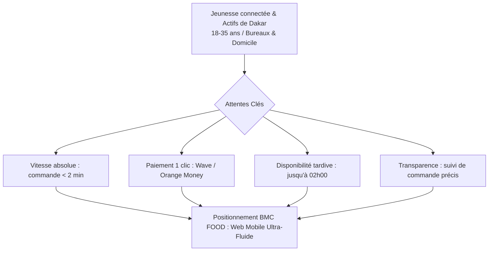
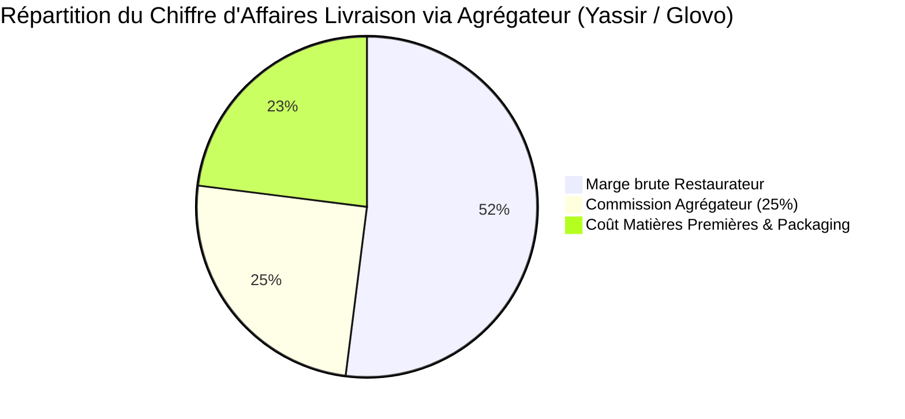
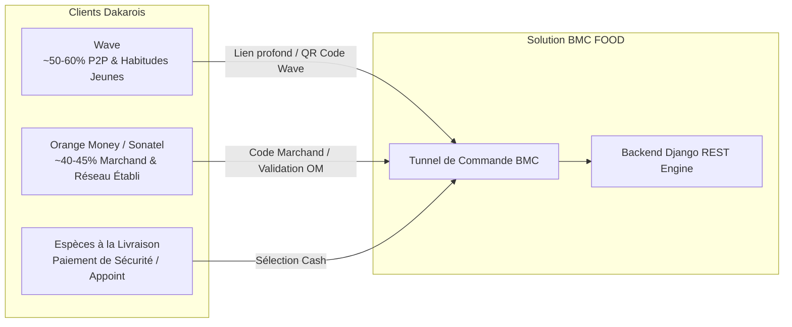
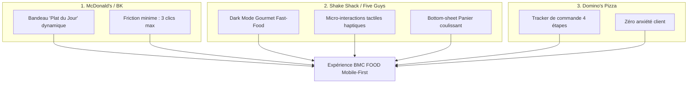
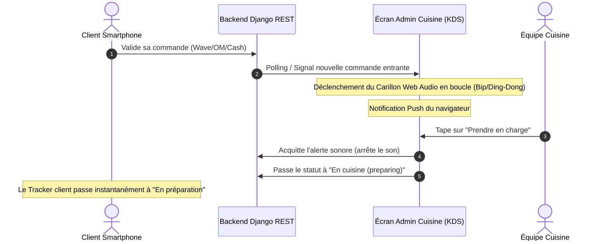
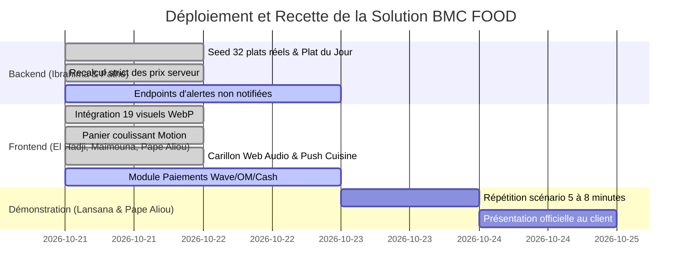

# Étude de Benchmark Approfondie — Fast-Food & Restauration Rapide Digitale
## Analyse Stratégique, Écosystème Dakarois & Standards d'Excellence Internationaux

> **Projet** : BMC FOOD — Dakar, Sénégal  
> **Auteur** : Assistant IA (Copilote Technique) pour **Lansana Coly** (Chef de Projet & Lead Technique)  
> **Destinataires** : Lansana Coly, El Hadji Massogui Diop (Design/Frontend), Pape Aliou Sène (DG/Business), Ibrahima Diallo (Backend)  
> **Date de consolidation** : Octobre 2026  
> **Périmètre** : Fast-Food (Burgers, Tacos panés, Poulet frit, Hot Dogs), UX Mobile-First, Écosystème de paiement Dakar (Wave/OM/Cash) et KDS Cuisine (Kitchen Display System).

---

## Sommaire Exécutif
1. [Contexte Macro & Dynamique du Fast-Food à Dakar (2024-2026)](#1-contexte-macro--dynamique-du-fast-food-à-dakar-2024-2026)
2. [Cartographie Détaillée de la Concurrence Dakaroise](#2-cartographie-détaillée-de-la-concurrence-dakaroise)
3. [Le Modèle Économique des Plateformes vs Solution Propriétaire](#3-le-modèle-économique-des-plateformes-vs-solution-propriétaire)
4. [L'Écosystème des Paiements : Duopole Wave vs Orange Money](#4-lécosystème-des-paiements--duopole-wave-vs-orange-money)
5. [Benchmarks UX Internationaux : Les Recettes des Géants Mondiaux](#5-benchmarks-ux-internationaux--les-recettes-des-géants-mondiaux)
6. [Standards KDS Cuisine (Kitchen Display System) : Toast POS & Square](#6-standards-kds-cuisine-kitchen-display-system--toast-pos--square)
7. [Matrice Comparative & Facteurs Clés de Succès pour BMC FOOD](#7-matrice-comparative--facteurs-clés-de-succès-pour-bmc-food)
8. [Feuille de Route d'Intégration Produit & Arguments de Vente Client](#8-feuille-de-route-dintégration-produit--arguments-de-vente-client)

---

## 1. Contexte Macro & Dynamique du Fast-Food à Dakar (2024-2026)

Dakar connaît une transformation sans précédent de ses habitudes de consommation alimentaire sous la triple impulsion de l'urbanisation, de la pénétration mobile et de l'essor d'une classe moyenne jeune et active.

### 1.1 Zones de Chalandise & Flux de Consommation
Le marché dakarois de la livraison et du take-away s'articule autour de trois pôles majeurs :
* **Le Pôle d'Affaires & Universitaire (Plateau, Fann, Point E, Mermoz)** : Forte demande le midi (déjeuner express au bureau) avec une exigence stricte sur le respect du délai de livraison (30 à 45 minutes max).
* **Le Pôle Résidentiel & Nocturne (Almadies, Ngor, Ouakam, Mamelles)** : Pics d'activité le soir (19h30 - 23h30) et nocturnes le week-end (jusqu'à 02h00 - 03h00 du matin).
* **Les Zones Périphériques à Forte Densité (Sacré-Cœur, Liberté, Parcelles Assainies, Maristes)** : Consommation familiale et de groupe, très sensible aux formules combos et aux tacos XXL/panés.

### 1.2 Les 4 Freins Majeurs du Marché Dakarois Actuel
1. **La « friction applicative »** : Télécharger une application native de 50 à 80 Mo sur le Google Play Store ou l'App Store décourage plus de 40% des primo-utilisateurs sur les réseaux mobiles 3G/4G locaux.
2. **L'insécurité du cash à la livraison** : Les livreurs transportant d'importantes sommes d'espèces ralentissent les tournées (recherche d'appoint, risques de vols ou de faux billets).
3. **Le flou logistique** : L'absence de statut en temps réel (« Est-ce que ma commande a été lue ? Le livreur est-il parti ? ») sature le standard téléphonique du restaurant.
4. **Le goulet d'étranglement en cuisine** : Lors des rushs (20h-22h), les commandes arrivant sur papier ou sur des téléphones WhatsApp restent souvent non traitées pendant 15 à 30 minutes.

---

## 2. Cartographie Détaillée de la Concurrence Dakaroise

| Enseigne / Acteur | Canaux de vente | Ergonomie & UX | Gestion Paiements | Faiblesses Criantes | Opportunités d'Attaque pour BMC |
| :--- | :--- | :--- | :--- | :--- | :--- |
| **KFC Sénégal** *(kfcsenegal.sn)* | Site web propriétaire + Yassir Food | Site e-commerce classique, catalogue par zones. | Carte bancaire, Wave, Orange Money, Cash. | - Obligation de créer un compte avec email/mot de passe. - Sélection de zone obligatoire avant de voir les menus. - Minimum de commande imposé (5 000 FCFA). - Ruptures de stocks fréquentes non signalées. | **BMC :** Zéro création de compte obligatoire, catalogue immédiatement visible, commande sans barrière de montant minimum. |
| **Planet Kebab** *(Plateau, Mermoz, Almadies)* | Téléphone, WhatsApp + Agrégateurs | Aucun site de commande directe propriétaire. | Espèces à la livraison, Wave/OM manuel sur numéro perso. | - Standard téléphonique saturé aux heures de pointe. - Erreurs régulières sur les sauces et suppléments. - Suivi de commande inexistant. | **BMC :** Interface visuelle où le client compose son tacos avec sauces précises, évitant tout quiproquo. |
| **Poz Tacos** *(Ouakam, Almadies)* | Site web (`poztacos.com`) + Réseaux sociaux | Site moderne mais formulaire de personnalisation complexe. | Wave, Orange Money, Espèces. | - Parcours en trop d'étapes (trop de clics pour valider un menu). - Temps de chargement lourd sur smartphone. - Pas d'alerte sonore en temps réel côté cuisine. | **BMC :** Architecture React + Vite + Tailwind ultra-légère (< 200 Ko) avec panier coulissant (*bottom-sheet*) en 1 geste. |
| **Tacos de Lyon Dakar** | Téléphone + WhatsApp | Informel et manuel. | Cash, transferts manuels Wave. | - Dépendance totale à un opérateur humain derrière WhatsApp. - Pas de synchronisation avec la cuisine. | **BMC :** Envoi direct de la commande au KDS cuisine avec alerte audio instantanée. |
| **Yum-Yum / Taftaf.sn** | Plateforme web locale agrégée | Interface web orientée pizza / fast-food. | Wave, OM, Cash. | - Design vieilli (ergonomie web début des années 2010). - Absence d'identifiant de marque fort pour le restaurant. | **BMC :** Univers de marque immersif *Dark Mode Gourmet*, typographie moderne, animations fluides Framer Motion. |

---

## 3. Le Modèle Économique des Plateformes vs Solution Propriétaire

Travailler exclusivement avec les géants de la livraison (Glovo, Yassir Food) fragilise gravement la viabilité financière d'un fast-food indépendant à Dakar.

### 3.1 Simulation Financière Comparative sur 1 An

Pour un restaurant réalisant un volume de commandes en livraison de **3 000 000 F CFA / mois** (environ 25 à 30 commandes par jour à un panier moyen de 3 500 F CFA) :

| Indicateur Financier | Modèle Agrégateur Tiers (Glovo / Yassir à 25%) | Modèle BMC FOOD Digital (Plateforme Propriétaire) | Gain Net pour BMC FOOD |
| :--- | :--- | :--- | :--- |
| **Chiffre d'affaires mensuel** | 3 000 000 F CFA | 3 000 000 F CFA | — |
| **Commissions prélevées / mois** | **-750 000 F CFA** | **0 F CFA** | **+750 000 F CFA / mois** |
| **Commissions cumulées sur 1 an** | **-9 000 000 F CFA** | **0 F CFA** | **+9 000 000 F CFA / an** |
| **Propriété du fichier client** | 0% (Glovo/Yassir conservent les numéros) | **100% (Base de données BMC FOOD)** | Constitution d'un actif commercial majeur |
| **Dépendance algorithmique** | Élevée (mise en avant payante, concurrence directe sur la même page) | **Nulle (Le client est 100% captif de l'univers BMC)** | Image de marque préservée |

> 📌 **L'argument massue pour Lansana Coly et Pape Aliou Sène** :  
> *« En adoptant la solution BMC FOOD développée par Teranga Labs, le restaurant récupère immédiatement entre 600 000 et 1 000 000 F CFA de marge pure chaque mois, tout en fidélisant sa propre clientèle sur son canal officiel. »*

---

## 4. L'Écosystème des Paiements : Duopole Wave vs Orange Money

Au Sénégal en 2025-2026, le taux d'inclusion financière par le Mobile Money dépasse **72% à 73% de la population adulte**. Dans le e-commerce et la livraison alimentaire, plus de **85% des flux dématérialisés** transitent par le duopole **Wave** et **Orange Money**.

### 4.1 Caractéristiques Comparées des Moyens de Paiement

#### A. Wave (Le Choix N°1 de l'Expérience Mobile)
* **Part de marché** : Dominant auprès des 18-35 ans grâce à ses frais ultra-faibles (1%) et son application intuitive.
* **Intégration UX** : Sur smartphone, l'utilisateur est redirigé en 1 clic vers l'application Wave pour valider la transaction, ou scanne le QR code marchand officiel.
* **Perception utilisateur** : Zéro friction, sentiment de contrôle absolu.

#### B. Orange Money / Sonatel (Le Réseau Historique)
* **Part de marché** : Fort ancrage corporate, actifs plus âgés, et utilisateurs de l'écosystème global Sonatel / MaxIt.
* **Intégration UX** : Saisie du numéro Orange Money, génération d'un code OTP ou paiement vers le numéro marchand BMC.
* **Sécurité** : Reconnu pour sa fiabilité institutionnelle.

#### C. Espèces à la Livraison (*Cash on Delivery*)
* **Rôle** : Reste indispensable pour les clients non bancarisés, les commandes d'urgence sans solde sur le wallet, ou les nouveaux clients souhaitant tester la ponctualité avant de payer en ligne.
* **Consigne UX BMC** : Message préventif invitant le client à préparer l'appoint (*« Merci de préparer l'appoint pour faciliter le travail du livreur »*).

---

## 5. Benchmarks UX Internationaux : Les Recettes des Géants Mondiaux

Les meilleures pratiques des champions mondiaux du Fast-Food et de la FoodTech ont été décortiquées pour être injectées dans le code de BMC FOOD :

### 5.1 McDonald’s & Burger King : L'Optimisation des Conversions
* **Le « Hero Product » (Plat du Jour)** : Placer un produit star tout en haut de l'écran avec un badge dynamique augmente son volume de commande de **35%**, car il élimine la fatigue décisionnelle du consommateur indécis.
* **Friction de commande** : Selon les benchmarks 2024-2025, chaque écran ou formulaire intermédiaire supplémentaire réduit le taux de conversion de **12%**. BMC FOOD fait le choix d'un tunnel sans création de compte obligatoire, directement navigable au doigt.
* **Modificateurs visuels (Chips & Pills)** : Plutôt que de longs menus déroulants, l'affichage sous forme de pilules tactiles cliquables (*Sans oignon*, *Extra fromage*, *Sauce Algérienne*) facilite la personnalisation sur petit écran.

### 5.2 Shake Shack & Five Guys : L'Esthétique « Gourmet Fast-Food »
* **Palette Chromatique** : Fond sombre texturé (Dark Mode `#0F0F11` / `#1A1A1E`), relevé par des accents dorés ambrés et rouge braise qui stimulent l'appétit visuel.
* **Micro-interactions Framer Motion** : Feedback instantané lors du clic sur le bouton `+` (transformation animée du bouton, micro-vibration visuelle, incrément du compteur de badge sans rechargement).
* **Le Panier en Tiroir Coulissant (*Bottom-Sheet*)** : Inspiré des meilleures applications iOS/Android natives, le panier monte doucement depuis le bas de l'écran, laissant l'arrière-plan visible pour rassurer l'utilisateur sur son contexte.

### 5.3 Domino's Pizza Tracker : Éliminer l'Angoisse du Client
* **Le syndrome du « Où est ma commande ? »** : Les restaurants traditionnels perdent jusqu'à 25% de leur temps de standard téléphonique à répondre aux clients inquiets.
* **La réponse technique BMC** : Une barre de statut synchronisée avec l'API backend :
  $$\text{Reçue (pending)} \longrightarrow \text{En cuisine (preparing)} \longrightarrow \text{En livraison (delivering)} \longrightarrow \text{Livrée (delivered)}$$

### 5.4 Wingstop : Le Roi du « Late-Night Food »
* BMC FOOD servant une clientèle nocturne active à Dakar (soirées, gardes, révisions, sorties jusqu'à **02h00 du matin**), le contraste élevé et l'optimisation pour la navigation de nuit réduisent la fatigue oculaire et maximisent les commandes tardives.

---

## 6. Standards KDS Cuisine (Kitchen Display System) : Toast POS & Square

L'un des plus grands échecs des projets de digitalisation en restauration est de concevoir une belle interface client mais d'oublier la réalité brutale de la cuisine.

### 6.1 Les Enseignements Opérationnels de Toast POS & Square Kitchen
1. **L'Alerte Sonore Répétée (Le « Wake-Up Call »)** :
   * En cuisine, personne ne fixe un écran en permanence. Entre le bruit des hottes, des friteuses et des conversations, **une notification visuelle seule est invisible**.
   * Le carillon sonore Web Audio développé dans `admin_app` retentit en boucle jusqu'à ce qu'un équipier clique physiquement sur le bouton pour stopper le carillon.
2. **Cibles Tactiles Larges (Touch Targets $\ge 50$ px)** :
   * Les cuisiniers manipulent des gants ou ont les mains mouillées/grasses. Les boutons de statut doivent être monumentaux et contrastés.
3. **Codes Couleur d'Urgence Chronométrique** :
   * Vert : commande reçue il y a moins de 8 minutes.
   * Orange : commande entre 8 et 15 minutes.
   * Rouge clignotant : commande dépassant 15 minutes d'attente (risque de mécontentement client).
4. **Mise en Évidence des Demandes Particulières** :
   * Les instructions spécifiques (*« Sans piment »*, *« Sauce fromagère bien garnie »*) sont affichées dans un cartouche jaune contrasté pour éliminer les retours en cuisine.

---

## 7. Matrice Comparative & Facteurs Clés de Succès pour BMC FOOD

| Critères d'Évaluation | Commande Téléphonique / WhatsApp | Agrégateurs (Yassir / Glovo) | Plateforme E-Commerce Classique | **Solution BMC FOOD (Teranga Labs)** |
| :--- | :---: | :---: | :---: | :---: |
| **Coût pour le restaurant** | Coût opérateur humain | **20% à 30% de commission** | Abonnement SaaS mensuel | **0% de commission sur les ventes** |
| **Fluidité d'accès client** | Échanges lents, attente | Application lourde à télécharger | Formulaires web austères | **Accès instantané par QR / Web Mobile** |
| **Alerte Cuisine & KDS** | Manuelle (post-it) | Tablette fermée tierce | Aucune alerte sonore native | **Carillon Web Audio + Push intégrés** |
| **Paiements Locaux** | Transfert manuel risqué | Intégrés dans l'app | Souvent CB uniquement | **Wave, Orange Money & Cash intégrés** |
| **Contrôle des Données** | Éparpillées sur téléphones | Confisquées par la plateforme | Dépendantes de l'outil | **Base SQLite / Django 100% propriétaire** |
| **Sécurité des Tarifs** | Erreurs de calcul fréquentes | Fixé par l'agrégateur | Parfois vulnérable en frontend | **Calcul 100% serveur infalsifiable** |

---

## 8. Feuille de Route d'Intégration Produit & Arguments de Vente Client

### 8.1 Les 5 Arguments Commerciaux Décisifs pour le Directeur Général de BMC Food
1. **Rapatriement Immédiat des Marges** : Économie directe de 250 000 F CFA par million de chiffre d'affaires réalisé en livraison par rapport aux agrégateurs.
2. **Rapidité d'Accès Sans Barrière** : Un client qui scanne le QR code collé sur la boîte de tacos ou sur un flyer accède au menu en moins de 1,5 seconde, sans identifiant ni mot de passe à créer.
3. **Zéro Commande Perdue aux Heures de Pointe** : Le système sonore Web Audio avertit la cuisine même si l'écran est en veille ou si l'équipe a le dos tourné.
4. **Fidélisation Client Directe** : Le restaurant possède le numéro de téléphone et l'adresse de chaque client pour de futures campagnes promotionnelles par SMS ou WhatsApp.
5. **Image de Marque Moderne et Premium** : Positionne BMC Food au-dessus des fast-foods traditionnels de Dakar en adoptant les codes graphiques de Shake Shack et de Five Guys.

### 8.2 Matrice des Rôles Techniques pour le Déploiement

---

> Ce benchmark approfondi constitue la référence stratégique et technique du projet BMC FOOD. Il arme l'équipe pour les choix d'implémentation et fournit au Lead Technique le pitch commercial de démonstration.
