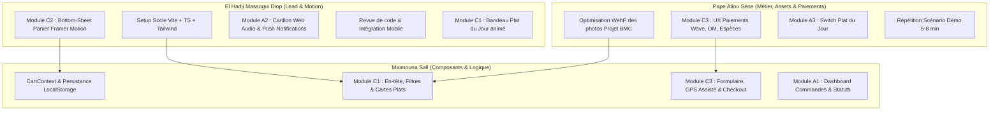

# Plan de Dispatching & Spécifications Opérationnelles — Faction Frontend & Design

> **Projet** : BMC FOOD — Prototype Web Fonctionnel MVP  
> **Auteur & Responsable Faction** : El Hadji Massogui Diop  
> **Contributeurs** : Maimouna Sall, Pape Aliou Sène  
> **Supervision & Validation Lead Tech** : Lansana Coly  
> **Version** : 1.1 — Document Opérationnel de Référence (mis à jour le 21/10/2026 après la livraison des tâches EH-1 à EH-4)  
> **Dépôt Git** : `lansanacoly7/BMC_FOOD` | **Branches cibles** : `feature/frontend/*`

---

## 1. Vision Stratégique & Cadre d'Exécution

La Faction Frontend & Design a la responsabilité de concevoir et livrer deux applications web d'excellence :
1. **Le Site Web Client (Mobile-First)** : Une expérience de commande en ligne ultra-fluide pour smartphone à Dakar (Tacos, Burgers, Sauces), mettant en vedette le *Plat du Jour* avec paiement adapté au marché sénégalais (**Espèces, Wave, Orange Money**).
2. **L'Application Web Admin Restaurateur** : Un tableau de bord temps réel pour la cuisine et la caisse de BMC Food, doté d'une **alerte sonore persistante (carillon Web Audio)** et de notifications push pour ne rater aucune commande.

Toutes les interfaces doivent être testées et optimisées pour les résolutions mobiles (360px, 390px, 414px) et répondre aux critères de la grille d'audit de Lansana Coly.

---

## 2. Standards Techniques Communs & Conventions

- **Framework & Bundler** : React 18/19 + TypeScript + Vite
- **Styles & Design System** : Tailwind CSS v4 — la charte est déclarée dans `src/index.css` (bloc `@theme`), il n'y a plus de `tailwind.config.js`
  - *Orange braise BMC* : `#F97316` (accent chaud) → `bg-bmc-orange`. **Texte anthracite dessus, jamais blanc** (contraste 2,8:1 insuffisant).
  - *Orange profond* : `#C2410C` → `text-bmc-orange-deep` pour du texte orange sur fond clair (contraste AA).
  - *Jaune moutarde doré* : `#F59E0B` (badges, prix, mise en valeur) → `bg-bmc-gold`, `text-bmc-gold`
  - *Fond sombre / Noir charbon* : `#18181B` (contraste élevé, lisibilité cuisine) → `bg-bmc-charcoal`
  - *Blanc cassé* : `#FAFAFA` (fond épuré client) → `bg-bmc-offwhite`
  - Polices : `font-display` (Bricolage Grotesque) pour les titres et les prix, `font-sans` (Inter) pour le texte.
- **Animations** : Framer Motion (`motion.div`, `AnimatePresence`), importé depuis `motion/react` (paquet officiel `motion`)
- **Icônes** : `lucide-react`
- **Audio & Push** : Web Audio API native (synthèse d'ondes sonores) + HTML5 Notification API
- **Structure des branches Git** :
  - Branche principale frontend : `feature/frontend/client-website`
  - Branche admin : `feature/frontend/admin-app`
  - Branches individuelles : `feature/frontend/[prenom]-[module]` (ex: `feature/frontend/elhadji-motion`, `feature/frontend/maimouna-cart`)
- **Emplacement des fichiers** (guide de collaboration GitHub) : tout le code du site client va dans `client_website/`, tout le code de l'admin dans `admin_app/`. Les chemins `src/...` des fiches ci-dessous sont relatifs à ces dossiers.
- **Données & API** : les modèles TypeScript de `src/types/index.ts` reprennent exactement les champs JSON de Django (`snake_case`). Ce fichier est identique dans les deux applications : toute modification doit être reportée dans les deux. Appels HTTP via `apiRequest<T>()` (`src/services/api.ts`), montants affichés avec `formatFcfa()` (`src/lib/format.ts`).

---

## 3. Fiches de Mission Ultra-Détaillées par Équipier

---

### 👤 Fiche 1 — El Hadji Massogui Diop
**Rôle** : Responsable Faction, Direction Artistique, Animations Avancées & Audio  
**Branches Git de travail** : `feature/frontend/client-website`, `feature/frontend/elhadji-*`

#### 📌 Tâche EH-1 : Initialisation du Socle Technique & Design System
* **Objectif** : Mettre en place l'environnement de développement, configurer Tailwind CSS avec la charte BMC Food, les polices Google Fonts et les types TypeScript partagés.
* **Fichiers impactés** (dans `client_website/` et dans `admin_app/`) :
  - `package.json`, `tsconfig.json`, `vite.config.ts` (ports fixes : client 5173, admin 5174)
  - `src/types/index.ts` (modèles `Product`, `Category`, `Order`, `OrderItem`, `PaymentMethod`, `OrderStatus`)
  - `src/index.css` (charte Tailwind v4 `@theme` : tokens de couleurs, polices, styles de base)
  - `src/services/api.ts` (`apiRequest<T>()`, `ApiError`, URL configurable via `VITE_API_BASE_URL`), `src/lib/format.ts` (`formatFcfa()`)
* **Critères d'Acceptation (DoD)** :
  - Le projet compile avec `npm run dev` et `npm run build` sans avertissement TypeScript.
  - La palette BMC Food est disponible via classes Tailwind (`bg-bmc-orange`, `text-bmc-gold`, etc.).
* **Statut** : ✅ Livré (branches `feature/frontend/client-website` et `feature/frontend/admin-app`).

#### 📌 Tâche EH-2 : Module C2 — Tiroir Panier Animé (*Bottom-Sheet* Framer Motion)
* **Objectif** : Créer l'expérience du panier coulissant depuis le bas de l'écran, optimisé pour une manipulation à une main sur smartphone.
* **Fichiers impactés** :
  - `client_website/src/components/cart/CartDrawer.tsx`
  - `client_website/src/components/cart/CartItemRow.tsx`
* **Spécifications d'Animation** :
  - Apparition fluide par glissement vertical (`initial={{ y: "100%" }} animate={{ y: 0 }}`).
  - Fermeture soit par clic sur le fond assombri (*backdrop backdrop-blur-sm*), soit par glissement vers le bas (*drag="y" dragConstraints={{ top: 0 }}*).
  - Micro-animations de rebond sur les boutons d'incrément/décrément (`scale: 0.95`).
* **Critères d'Acceptation (DoD)** :
  - Gestuelle tactile 60 FPS sur mobile.
  - Affichage instantané du récapitulatif des articles et du bouton d'action vers le formulaire.
* **Statut** : ✅ Livré sur `feature/frontend/client-website`. Fermeture par ✕, Échap, clic sur le fond ou glissement de la poignée ; recette 360/390/414 px validée.
* **Branchement** : composant de présentation piloté par props (`isOpen`, `onClose`, `items`, `onUpdateQuantity(code, quantité)`, `onRemove(code)`, `onCheckout`), à relier au `CartContext` (MS-1) et au `CheckoutModal` (MS-3).

#### 📌 Tâche EH-3 : Module A2 — Système d'Alertes Actives Cuisine (Sonnerie Web Audio & Push)
* **Objectif** : Créer le mécanisme d'alerte pour l'application admin garantissant qu'aucune commande entrante ne passe inaperçue en cuisine.
* **Fichiers impactés** :
  - `admin_app/src/services/audioAlertService.ts`
  - `admin_app/src/services/notificationService.ts`
  - `admin_app/src/components/admin/AlertModal.tsx`
  - `admin_app/src/components/admin/AlertActivationPrompt.tsx` (écran « Démarrer le service »)
  - `admin_app/src/hooks/useNewOrderAlerts.ts` (interrogation de l'API, sonnerie, notifications, acquittement)
* **Spécifications Techniques** :
  - **Synthèse Sonore Web Audio** : Générer une mélodie à deux tons (ex: 880 Hz puis 1174 Hz) via un `AudioContext` natif, répétée toutes les 3 secondes tant que la commande n'a pas été acquittée par un clic sur « Prendre en charge ». Pas de dépendance de fichier MP3 externe pour éviter les erreurs de chargement réseau.
  - **Notification API** : Demander la permission à l'ouverture de l'admin. Envoyer la notification navigateur avec le titre *« 🔔 Nouvelle commande BMC-XXXX »* et le corps *« Montant : X XXX F CFA »*.
* **Critères d'Acceptation (DoD)** :
  - La sonnerie démarre dès qu'une commande `is_notified_to_admin === false` est reçue.
  - L'acquittement stoppe le son immédiatement et marque l'alerte comme traitée.
* **Statut** : ✅ Livré sur `feature/frontend/admin-app`, testé de bout en bout contre le backend Django.
* **À savoir pour la démo** : les navigateurs bloquent le son tant que personne n'a cliqué sur la page. À l'ouverture, l'admin affiche donc l'écran « Démarrer le service » : un clic sur « Activer les alertes » débloque la sonnerie et demande l'autorisation des notifications. Le bouton « Tester la sonnerie » permet de vérifier le son avant le service.

#### 📌 Tâche EH-5 : Module C1 — Bandeau Plat du Jour Animé
* **Objectif** : Mettre en avant le Plat du Jour en tête du site client avec une animation soignée (critère d'audit « Plat du jour bien mis en avant avec Motion »).
* **Fichiers impactés** :
  - `client_website/src/components/client/DailySpecialBanner.tsx`
  - `client_website/src/hooks/useDailySpecials.ts`
* **Spécifications** :
  - Données de `GET /api/daily-special/`, rafraîchies toutes les 10 secondes et au retour sur l'onglet : un changement fait dans l'admin (A3) apparaît sans recharger la page.
  - Badge « Plat du jour » animé, carte sombre et dorée, prix serveur en F CFA, bouton « Ajouter » avec confirmation « Ajouté ».
  - Plusieurs plats du jour : cartes défilables au doigt (pas de rotation automatique). Aucun plat ou API injoignable : bandeau masqué, le reste du site fonctionne.
* **Statut** : ✅ Livré sur `feature/frontend/elhadji-daily-special`. Recette 360/390/414 px validée contre le backend Django.
* **Branchement** : `<DailySpecialBanner specials={specials} isLoading={isLoading} onAdd={addToCart} />` avec `const { specials, isLoading } = useDailySpecials()`, à placer sous le `Header` (MS-2).

#### 📌 Tâche EH-4 : Revue de Code, Contrôle Qualité & Clôture de Branche
* **Objectif** : Vérifier le respect des standards, l'absence d'erreurs en console, et préparer les Pull Requests pour validation par Lansana Coly.
* **Statut** : ✅ Livré pour EH-1 à EH-3 (build et lint sans erreur ni avertissement, recettes automatisées dans Chrome). Les PR vers `develop` sont prêtes. La revue des modules de Maimouna et Pape Aliou se fera à leur livraison.

---

### 👤 Fiche 2 — Maimouna Sall
**Rôle** : Ingénieure Frontend, Intégration Composants & Connexions API  
**Branches Git de travail** : `feature/frontend/maimouna-*`

#### 📌 Tâche MS-1 : Gestionnaire d'État Global du Panier (`CartContext`)
* **Objectif** : Développer le contexte React permettant d'ajouter, soustraire, supprimer des articles, calculer le montant total et synchroniser les données dans le `localStorage`.
* **Fichiers impactés** :
  - `client_website/src/context/CartContext.tsx`
  - `client_website/src/hooks/useCart.ts`
* **Critères d'Acceptation (DoD)** :
  - Les articles restent enregistrés dans le panier même après un rechargement de la page (F5).
  - Le calcul du sous-total gère correctement les centimes et l'arrondi en Francs CFA.
  - Fournit les méthodes `addToCart()`, `removeFromCart()`, `updateQuantity()`, `clearCart()`.
* **Contrat avec le tiroir panier (EH-2)** :
  - Stocker des `CartItem` (`{ product: Product; quantity: number }`, déjà défini dans `src/types/index.ts`).
  - Identifier les plats par `product.code` (ex. `tp-1`) : `removeFromCart(code)` et `updateQuantity(code, quantité)` se branchent alors directement sur `onRemove` et `onUpdateQuantity` du `CartDrawer`.
  - Remplacer l'état local provisoire de `client_website/src/App.tsx` par le contexte.

#### 📌 Tâche MS-2 : Module C1 — En-tête, Défilement des Catégories & Grille des 32 Plats
* **Objectif** : Intégrer la page d'accueil du site client avec tous les produits réels de BMC Food.
* **Fichiers impactés** :
  - `client_website/src/components/client/Header.tsx` (Logo BMC, horaires 11h-02h, téléphones 77 856 13 13 / 77 106 75 75)
  - ~~`client_website/src/components/client/DailySpecialBanner.tsx`~~ : livré par El Hadji (tâche EH-5), à placer sous le `Header`
  - `client_website/src/components/client/CategoryScroll.tsx` (Barre de défilement horizontal tactile des 7 catégories)
  - `client_website/src/components/client/ProductCard.tsx` (Carte avec photo optimisée, prix en F CFA, badge catégorie, bouton d'ajout)
* **Critères d'Acceptation (DoD)** :
  - Filtrage instantané des produits lors du clic sur une catégorie sans rechargement.
  - L'ajout d'un plat au panier déclenche un micro-feedback visuel (badge compteur qui s'anime).

#### 📌 Tâche MS-3 : Module C3 — Formulaire de Commande, Géolocalisation GPS & Soumission
* **Objectif** : Construire le parcours de validation de commande jusqu'à l'écran de confirmation final.
* **Fichiers impactés** :
  - `client_website/src/components/checkout/CheckoutModal.tsx`
  - `client_website/src/components/checkout/GPSLocator.tsx`
  - `client_website/src/components/checkout/OrderConfirmation.tsx`
* **Spécifications Métier** :
  - Champs requis : Nom & Prénom, Téléphone (validation format Sénégal +221 ou 9 chiffres), Adresse ou point de repère.
  - Bouton « 📍 Me localiser (GPS) » utilisant `navigator.geolocation.getCurrentPosition()`. Si accordé, convertir les coordonnées en texte de repère géographique ou latitude/longitude, avec champ de précision manuelle en repli.
  - Envoi de la commande vers l'API backend (`POST /api/orders/`) avec `apiRequest<OrderResponse>()`. Le corps (`OrderCreatePayload`) ne contient jamais de prix : uniquement `{ id: code, quantity }` par article, le serveur recalcule le total. En cas d'erreur 400, les messages de validation DRF sont dans `ApiError.payload.errors`.
  - Écran de succès affichant le numéro de suivi officiel : `BMC-XXXX`.
* **Critères d'Acceptation (DoD)** :
  - Validation client stricte des champs avant soumission.
  - En cas de succès, le panier est vidé et la confirmation est présentée avec un bouton de contact direct WhatsApp/Appel.

#### 📌 Tâche MS-4 : Module A1 — Tableau de Bord Cuisine & Gestion du Cycle de Vie
* **Objectif** : Développer l'interface de visualisation et de gestion des commandes pour le restaurateur.
* **Fichiers impactés** :
  - `admin_app/src/components/admin/AdminDashboard.tsx`
  - `admin_app/src/components/admin/OrderCard.tsx`
  - `admin_app/src/components/admin/StatusBadge.tsx`
* **Spécifications Fonctionnelles** :
  - Affichage en colonnes Kanban ou liste contrastée selon les 4 états officiels :
    `En attente (pending)` $\rightarrow$ `En cuisine (preparing)` $\rightarrow$ `En livraison (delivering)` $\rightarrow$ `Livrée (delivered)`.
  - Bouton d'action en 1 clic pour faire passer la commande à l'état suivant via l'API (`PATCH /api/orders/{id}/status/`).
  - Polling automatique toutes les 5 à 10 secondes pour détecter les nouvelles commandes sans rafraîchir manuellement.
* **Critères d'Acceptation (DoD)** :
  - La progression du statut met à jour visuellement la commande sans latence.
  - Le montant recalculé par le serveur est clairement mis en valeur.
* **Intégration avec les alertes (EH-3)** :
  - Le tableau de bord prend place dans le `<main>` de `admin_app/src/App.tsx` (emplacement commenté).
  - La sonnerie et les notifications sont déjà gérées par `useNewOrderAlerts` : le tableau de bord n'a rien à faire pour elles.
  - Réutiliser `apiRequest<T>()`, `formatFcfa()`, `formatTime()` et `PAYMENT_METHOD_LABELS` (`src/lib/labels.ts`).

---

### 👤 Fiche 3 — Pape Aliou Sène
**Rôle** : Porteur Métier BMC, Responsable Assets Visuels, UX des Paiements Locaux & Démonstration  
**Branches Git de travail** : `feature/design/assets-and-ux`, `feature/frontend/*`

#### 📌 Tâche PA-1 : Traitement & Optimisation WebP des Photos Réelles BMC
* **Objectif** : Préparer tous les visuels du dossier [`Projet BMC/`](file:///c:/Users/DELL/OneDrive/Images/Документы/cours/BMC/Projet%20BMC) pour garantir un affichage instantané sur les téléphones mobiles 3G/4G à Dakar.
* **Livrables attendus** :
  - Dossier `client_website/public/images/products/` (le champ `image_url` des plats pointera vers `/images/products/<fichier>.webp`).
  - Conversion des fichiers haute définition (ex: `099D05B3-D5DE-4DBB-B6C7-9B32B9411FC7.png`, 2.4 Mo) au format `.webp`.
  - Poids unitaire strict inférieur à **150 Ko** par image.
  - Nommage standardisé cohérent avec le seed du backend (ex: `tacos-viande-pane.webp`, `burger-complet.webp`).
  - Logo officiel BMC Food (fond noir, toque dorée) en WebP pour l'en-tête du site (MS-2) et l'icône des applications.
* **Critères d'Acceptation (DoD)** :
  - Temps de chargement global du catalogue inférieur à 1,5 seconde sur mobile.

#### 📌 Tâche PA-2 : Module C3 (Partie Paiements) — Conception Visuelle Wave, OM et Espèces
* **Objectif** : Concevoir les interfaces de choix du moyen de paiement adaptées aux habitudes d'achat sénégalaises.
* **Fichiers impactés** :
  - `client_website/src/components/checkout/PaymentSelector.tsx`
  - `client_website/src/components/checkout/WavePaymentModal.tsx`
  - `client_website/src/components/checkout/OrangeMoneyModal.tsx`
* **Spécifications des 3 Modes de Paiement** :
  1. 💵 **Espèces à la livraison** : Option par défaut. Message clair : *« Préparez l'appoint pour le livreur »*.
  2. 🌊 **Wave** : Badge bleu officiel Wave, affichage du QR Code Marchand et lien de paiement direct Wave deep-link.
  3. 🍊 **Orange Money** : Badge orange officiel, rappel de la syntaxe marchande `#144#391#` et saisie du code OTP ou validation simulateur.
* **Critères d'Acceptation (DoD)** :
  - Présentation attrayante et crédible lors de la présentation client.
  - Le choix sélectionné est transmis fidèlement au backend (`cash`, `wave`, `orange_money`).

#### 📌 Tâche PA-3 : Module A3 — Recette & Validation du Switch "Plat du Jour"
* **Objectif** : Valider l'expérience côté restaurateur permettant de définir le produit phare quotidien.
* **Critères d'Acceptation (DoD)** :
  - Le switch active/désactive le statut du plat sans friction.
  - Vérification que la bannière du site client se met à jour instantanément.

#### 📌 Tâche PA-4 : Répétition & Maîtrise du Scénario de Démonstration (5 à 8 min)
* **Objectif** : Orchestrer le timing parfait de présentation auprès de la direction de BMC Food avec Lansana Coly.
* **Déroulé chronométré** :
  - **Min 0 - 1** : Accueil, univers BMC Food, numéros d'urgence, Plat du Jour.
  - **Min 1 - 3** : Sélection Tacos + Burger, panier tactile fluide, géolocalisation GPS.
  - **Min 3 - 4** : Paiement Wave / Espèces, validation et génération référence `BMC-XXXX`.
  - **Min 4 - 6** : **Effet Wow** : Bascule sur l'admin cuisine, **la sonnerie carillon retentit**, notification push, prise en charge et passage en cuisine.
  - **Min 6 - 8** : Conclusion commerciale et recueil des retours.
* **Préparation technique avant la démo** :
  - Le port 8000 doit être libre pour l'API Django : arrêter tout autre service qui l'occupe.
  - Ouvrir l'admin (`http://localhost:5174`), cliquer sur « Activer les alertes », accepter les notifications et cliquer sur « Tester la sonnerie », volume de l'ordinateur monté.
  - Garder l'onglet admin ouvert pendant toute la démo.

---

## 4. Matrice RACI Récapitulative

| Module & Fonctionnalité | El Hadji M. Diop | Maimouna Sall | Pape Aliou Sène | Lansana Coly |
| :--- | :---: | :---: | :---: | :---: |
| **Setup Vite, TS & Tailwind** | **R / A** | C | I | I |
| **Design System & Palette BMC** | **R / A** | C | C | I |
| **CartContext & LocalStorage** | C | **R / A** | I | I |
| **Catalogue & Catégories (C1)** | C | **R / A** | C | I |
| **Plat du Jour Animé (C1)** | **R / A** | C | C | I |
| **Tiroir Panier Motion (C2)** | **R / A** | C | I | I |
| **Formulaire & GPS (C3)** | C | **R / A** | C | I |
| **Paiements Wave/OM/Cash (C3)** | C | C | **R / A** | I |
| **Dashboard Commandes (A1)** | C | **R / A** | I | I |
| **Carillon Web Audio & Push (A2)** | **R / A** | C | I | I |
| **Optimisation Photos WebP** | I | I | **R / A** | I |
| **Switch Plat du Jour (A3)** | C | **R** | **R / A** | I |
| **Revue de Code & PRs** | **R / A** | C | C | **A (Lead)** |
| **Démonstration Client** | C | C | **R** | **A (Lead)** |

*Légende : **R** = Responsable de réalisation, **A** = Approbateur / Décideur final, **C** = Consulté, **I** = Informé.*

---

## 5. Calendrier d'Exécution & Jalons Clés

| Jalon | Date / Durée | Objectif Opérationnel | Faction Responsable |
| :--- | :---: | :--- | :--- |
| **Jalon 1 : Fondations** | Jour 1 | Socle technique opérationnel, types TS créés, images optimisées en WebP. | El Hadji & Pape Aliou |
| **Jalon 2 : Expérience Client** | Jours 2 - 3 | Catalogue complet, panier *bottom-sheet* fonctionnel, checkout GPS et sélecteur de paiement. | Maimouna & El Hadji |
| **Jalon 3 : Admin & Alertes** | Jours 3 - 4 | Dashboard cuisine interactif, carillon sonore en temps réel, push notifications. | El Hadji & Maimouna |
| **Jalon 4 : Répétition Générale** | Jour 5 | Intégration complète avec le backend Django, test du scénario 5-8 min, validation par Lansana. | Toute l'équipe |

---

## 6. Checklist de Conformité pour l'Audit de Lansana Coly

Avant de soumettre la Pull Request finale au Lead Technique, El Hadji Massogui Diop vérifiera que :
- [ ] Le site s'affiche parfaitement sur formats d'écrans mobiles (360px, 390px, 414px).
- [ ] La sonnerie carillon retentit automatiquement dès la réception d'une commande en attente.
- [ ] L'acquittement stoppe immédiatement la sonnerie.
- [ ] La notification push du navigateur s'affiche avec la référence `BMC-XXXX`.
- [ ] Le calcul des prix est garanti conforme au recalcul du serveur backend.
- [ ] Aucune erreur TypeScript (`npm run build` passe avec 0 erreur).
- [ ] Aucune erreur ou avertissement bloquant dans la console du navigateur.
