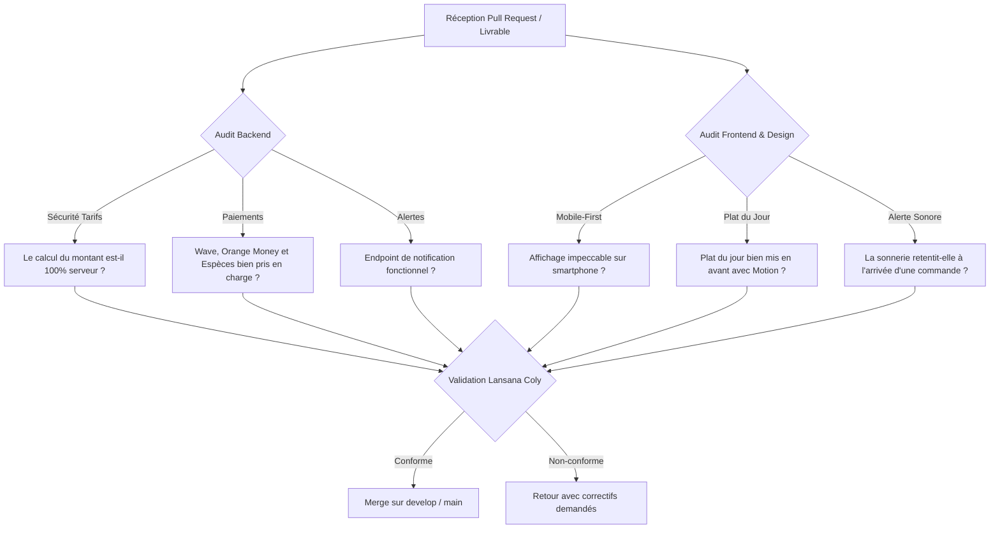

# Pilotage, Audits Qualité & Démonstration — Lead Technique

> **Responsable** : Lansana Coly (Chef de Projet & Lead Technique)  
> **Assistant IA** : Antigravity (IA)  
> **Organisation** : Teranga Labs  
> **Projet** : BMC Food

---

## 1. Rôle et Posture de l'Assistant IA (Antigravity)

L'assistant IA est le copilote exclusif de **Lansana Coly**. Ses prérogatives sont strictement encadrées :
- **Audit de qualité** : Analyser les codes sources et livrables déposés par les équipes Frontend et Backend, relever les failles, incohérences ou régressions.
- **Conseil et suggestions** : Proposer à Lansana les meilleures approches techniques, architecturales et organisationnelles.
- **Support de documentation** : Rédiger les rapports de synthèse, checklists et comptes-rendus.
- **Exécution sous mandat direct** : L'IA ne développe aucune fonctionnalité dévolue aux autres membres et n'exécute de commande ou de code que sur **demande explicite et validation de Lansana Coly**.

---

## 2. Grille d'Audit de Qualité (À l'attention du Lead Technique)

À chaque soumission de branche ou de livrable par une faction, l'audit suivant est exécuté :

### Critères d'Audit Backend (Ibrahima & Pathé)
- [ ] Les prix sont-ils impérativement recalculés en base (le client ne peut pas falsifier les montants) ?
- [ ] Les 32 articles réels et les 7 catégories sont-ils bien renseignés en Francs CFA ?
- [ ] Le champ `is_daily_special` permet-il d'activer et désactiver le Plat du Jour ?
- [ ] Le statut de commande respecte-t-il le cycle de vie (`pending` $\rightarrow$ `preparing` $\rightarrow$ `delivering` $\rightarrow$ `delivered`) ?
- [ ] L'endpoint `/api/orders/events/unnotified/` renvoie-t-il bien les commandes en attente pour la sonnerie ?

### Critères d'Audit Frontend & Design (El Hadji, Maimouna, Pape Aliou)
- [ ] Le site client est-il bien un **site web mobile-first** (pas de lourdeurs superflues) ?
- [ ] Le **Plat du Jour** est-il immédiatement visible avec une animation soignée ?
- [ ] Le panier coulissant (*bottom-sheet*) avec Framer Motion est-il fluide au toucher ?
- [ ] Les 3 options de paiement (**Espèces**, **Wave**, **Orange Money**) sont-elles claires et fonctionnelles ?
- [ ] L'application Admin déclenche-t-elle bien le **bip sonore / carillon** à la réception d'une commande ?
- [ ] La notification push du navigateur s'affiche-t-elle avec le numéro de commande ?

---

## 3. Protocole de Démonstration Commerciale (5 à 8 minutes)

Scénario conçu pour Lansana Coly et Pape Aliou Sène lors de la présentation au client BMC Food :

1. **Minute 1 — Accueil & Identité Restaurant (Mobile)** :
   - Présentation sur smartphone : logo, ambiance visuelle chaleureuse, numéros de commande (`77 856 13 13` / `77 106 75 75`).
   - Présentation du **Plat du Jour du chef**.
2. **Minutes 2 à 3 — Commande Client & Choix Wave / OM** :
   - Sélection d'un tacos pané et d'un burger.
   - Ouverture du panier animé, vérification des prix officiels.
   - Sélection du paiement **Wave** ou **Espèces**, saisie de l'adresse et validation.
   - Affichage immédiat de la référence de commande `BMC-XXXX`.
3. **Minutes 4 à 5 — L'Effet Wow : L'Application Admin Cuisine** :
   - Bascule sur l'écran Admin : la **sonnerie retentit instantanément** pour annoncer la commande !
   - La notification push apparaît à l'écran.
   - Le restaurateur clique sur « Prendre en charge » (la sonnerie s'arrête).
   - Passage en direct de la commande en *« En cuisine »* puis *« En livraison »*.
4. **Minutes 6 à 8 — Clôture & Recueil des Retours Client** :
   - Présentation du volume d'affaires sur le tableau de bord.
   - Recueil des retours du client pour la phase 2.
