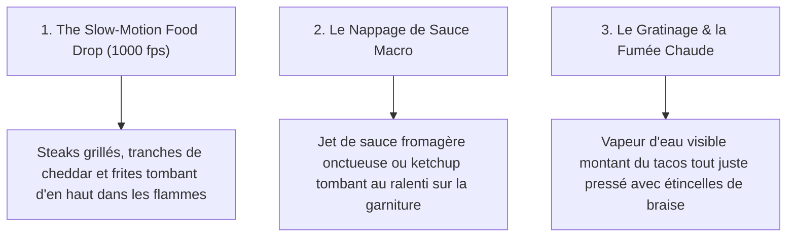

# Référentiel Officiel des Prompts Images (Option A & B) et Vidéos Publicitaires — Catalogue Réel BMC FOOD

> **Projet** : BMC FOOD — Fast-Food & Saveurs Gourmandes à Dakar  
> **Source Officielle** : `Projet BMC/Menu_BMC_FOOD_Noms_et_Prix.docx` (Catalogue exhaustif vérifié)  
> **Auteure & Responsable Frontend/UI** : Maimouna Sall  
> **Destinataires** : Pape Aliou Sène (Assets & Métier), El Hadji Massogui Diop (Lead Design), Lansana Coly (Lead Tech)  
> **Outils Cibles** : Google Flow / Imagen 3 (Images) & Runway Gen-3 / Sora / Luma / Veo (Vidéos publicitaires)  
> **Format Image** : Ratio 4:3 | Éclairage Studio Chaud & Sombre | Rendu Net & Propre (sans coulures excessives)  
> **Format Vidéo** : Slow-Motion 4K 1000fps | Effets Dynamiques (Flammes, Fumée chaude, Food Drop, Nappage sauce)  

---

## 1. Benchmark Publicitaire & Techniques Vidéo des Géants Mondiaux

En analysant les spots primés de **Burger King, Shake Shack, McDonald's et KFC International** :



### Les 4 Ingrédients d'un Prompt Vidéo Réussi :
1. **La Physique Dynamique ("Gravity & Food Drop")** : Éléments tombant du haut de l'écran vers le bas au ralenti (*ultra slow motion 1000fps*).
2. **Le Contraste Élémentaire (Feu & Vapeur)** : Braises incandescentes, flammes de grill en arrière-plan et vapeur chaude s'élevant délicatement du plat chaud.
3. **La Texture Macro** : Zoom avant continu (*dolly-in macro lens*) sur la découpe du tacos ou le croustillant du pain brioché.
4. **La Propreté Culinaire** : Des jets de sauce nets et maîtrisés (ketchup, sauce fromagère, sauce algérienne) sans effet baveux ou désordonné.

---

## 2. Le Catalogue Officiel BMC FOOD — Prompts Exhaustifs Produit par Produit

---

### SECTION 1 : LES TACOS PANÉS (SPÉCIALITÉS VEDETTES BMC)

> 💡 **Signature Visuelle Officielle des Tacos Panés BMC (Texture Chapelure Réelle)** :  
> Toute la surface extérieure du tacos est **entièrement enveloppée d'une panure de chapelure dorée ultra-croustillante et granuleuse** (style panure panko / chapelure orangée dense et frite à la perfection, texture visible à grains fins et dorés). La découpe nette révèle le contraste entre cette croûte de chapelure croustillante et le cœur fondant (viande assaisonnée, frites dorées, sauce fromagère onctueuse).

#### 1.1 Tacos Viande Pané (3 500 F CFA) — *Plat du Jour Officiel*
* **Composition officielle** : Viande hachée assaisonnée, frites dorées, sauce fromagère, **enveloppé d'une croûte épaisse de chapelure dorée croustillante et frite**.
* 📸 **Prompt Image — Option A (Coupe Nette & Texture de Chapelure Granuleuse)** :
  ```text
  Commercial food photography of an authentic French Tacos Viande Pané, sliced cleanly in half diagonally on a black slate platter. The entire exterior of the rectangular taco is coated in a thick, dense, intensely crispy golden-orange breadcrumb crust (coarse panko chapelure breading texture with visible crunchy granules). The cross-section sharply reveals the contrast: crunchy golden breaded exterior versus hot juicy seasoned minced beef, golden fries, and rich creamy cheese sauce inside. Dark charcoal background, warm amber side lighting highlighting the crunchy breadcrumb granules, finely chopped fresh parsley garnish, clean professional restaurant styling, sharp focus, no messy dripping sauce, no text, no watermark, no letters, 4:3 aspect ratio.
  ```
* 📸 **Prompt Image — Option B (Vue 45° Gros Plan sur la Panure & Ramequins Sauces)** :
  ```text
  Close-up 45-degree gourmet food shot of a French Tacos Pané fully coated in an ultra-crunchy, coarse golden-orange breadcrumb crust (chapelure panure) in high crisp texture. Sliced diagonally, steam rising softly from the juicy beef and melted cheese inside. Served on dark rustic slate with two neat ceramic ramekins of authentic Algerian sauce and signature cheese dip. Warm amber studio lighting emphasizing the golden fried breadcrumb coating, crisp details, no text, no words, no logo, 4:3 aspect ratio.
  ```
* 🎬 **Prompt Vidéo Publicitaire (Google Flow / Runway / Veo)** :
  ```text
  Cinematic 4K commercial at 1000fps ultra slow-motion. A sharp chef knife slices through an intensely crispy golden breadcrumb-crusted French Tacos with an audible, satisfying crunch. Delicate golden breadcrumb flakes scatter on the dark slate. The taco gently falls open, revealing steaming seasoned minced beef, golden fries, and warm creamy cheese sauce flowing softly in slow motion. Warm amber backlight, subtle embers, high-end food advertising.
  ```

---

#### 1.2 Tacos Poulet Pané (3 500 F CFA)
* **Composition officielle** : Morceaux de poulet marinés, frites, sauce fromagère, **panure complète de chapelure croustillante**.
* 📸 **Prompt Image — Option A** :
  ```text
  Professional commercial food photography of a French Tacos Poulet Pané, fully enveloped in a thick, crunchy golden-orange breadcrumb crust (coarse panko chapelure texture). Cut in half cleanly to reveal tender marinated grilled chicken breast chunks, golden french fries, and velvety white cheese sauce. Dark textured background, warm spotlight reflecting on the golden breadcrumb granules, clean presentation, no text, no watermark, 4:3.
  ```
* 📸 **Prompt Image — Option B** :
  ```text
  Appetizing food shot of a crispy breadcrumb-coated chicken French Tacos on dark stone board, accompanied by a small ramekin of Samurai sauce. Coarse golden breading texture sharply in focus, warm rim lighting, steam rising, clean fast-casual restaurant style, no text, 4:3.
  ```
* 🎬 **Prompt Vidéo Publicitaire** :
  ```text
  Slow motion 1000fps video: A chicken French Tacos emerges from golden bubbling oil with an ultra-crispy, textured breadcrumb crust glowing amber, landing on a dark cutting board as steam puffs out. Sliced open to reveal tender chicken in slow motion.
  ```

---

#### 1.3 Tacos Mixte Pané (Viande & Poulet) (4 000 F CFA)
* **Composition officielle** : Duo viande hachée et poulet grillé, frites, sauce fromagère, **enrobage total de chapelure dorée croustillante**.
* 📸 **Prompt Image — Option A** :
  ```text
  High-end studio food photography of a large French Tacos Mixte Pané, encased in a signature coarse golden-orange breadcrumb crust. Clean diagonal slice showing distinct layered filling of seasoned ground beef, grilled chicken cubes, crispy fries, and velvety cheese sauce. Dark slate surface, warm side lighting detailing the granular breaded crust, parsley garnish, clean look, no text, 4:3.
  ```
* 📸 **Prompt Image — Option B** :
  ```text
  Gourmet photograph of a breadcrumb-crusted French Tacos Mixte on dark wood platter with duo of Algerian and Barbecue dipping sauces. Intensely crunchy golden panko breading, warm lighting, appetizing steam, no words, 4:3.
  ```
* 🎬 **Prompt Vidéo Publicitaire** :
  ```text
  Dynamic commercial at 1000fps: Minced beef and chicken morsels drop into a folded tortilla, fully coated in golden breadcrumbs, sizzling in slow motion until perfectly crisp and golden brown with flying breadcrumb specks.
  ```

---

#### 1.4 Tacos Jambon Pané (3 000 F CFA)
* **Composition officielle** : Tranches de jambon fumé de dinde, frites, sauce fromagère, **panure complète de chapelure dorée**.
* 📸 **Prompt Image — Option A** :
  ```text
  Commercial food photography of a French Tacos Jambon Pané with a full outer layer of crunchy golden breadcrumbs (coarse chapelure panure). Sliced in half showing folded smoked turkey ham ribbons, golden fries, and rich creamy cheese sauce. Dark charcoal background, warm spotlight, sharp focus on the granular crunchy crust, no text, 4:3.
  ```
* 📸 **Prompt Image — Option B** :
  ```text
  Eye-level shot of a golden breadcrumb-crusted ham French Tacos on dark slate, with a small dish of mayonnaise. Crispy golden panko exterior, dark backdrop, soft warm glow, clean styling, no words, 4:3.
  ```
* 🎬 **Prompt Vidéo Publicitaire** :
  ```text
  Macro 4K slow motion commercial: Golden breadcrumb-coated taco is cut cleanly, revealing steaming smoked turkey ham and velvety melted cheese within the thick crunchy crust.
  ```

---

### SECTION 2 : LES TACOS JAMBON PANÉS (RECETTES COMPOSÉES)

#### 2.1 Tacos Viande Jambon Pané (4 500 F CFA)
* **Composition** : Viande hachée + Jambon fumé + Frites + Sauce fromagère + Tortilla panée.
* 📸 **Prompt Image — Option A** :
  ```text
  Studio food photography of a large French Tacos filled with seasoned beef and smoked turkey ham layers, crispy fries, and cheese sauce. Neatly cut in half showing rich multi-layered cross-section. Golden cheese crust on top, dark slate background, warm focused light, clean presentation, 4:3.
  ```
* 📸 **Prompt Image — Option B** :
  ```text
  Gourmet fast-food photograph of a double-meat French Tacos (minced beef and ham) resting on dark stone with small dipping cups of Algérienne and Samouraï sauces. Toasted grill marks, hot steam rising, warm ambient glow, 4:3.
  ```
* 🎬 **Prompt Vidéo Publicitaire** :
  ```text
  Super slow-motion commercial. Seasoned beef patty crumbles and ribbons of smoked turkey ham drop into a sizzling hot press with crispy fries. Steam billows as the press toasts the tortilla to a crunchy golden finish, golden embers drifting in the dark background.
  ```

#### 2.2 Tacos Poulet Jambon Pané (4 500 F CFA)
* **Composition** : Poulet mariné + Jambon fumé + Frites + Sauce fromagère + Panure.
* 📸 **Prompt Image — Option A** :
  ```text
  Commercial food photography of a French Tacos with chicken and smoked ham, sliced diagonally on black slate. Distinct appetizing layers of white chicken meat, pink smoked ham ribbons, and golden fries. Dark background, warm amber lighting, clean styling, 4:3.
  ```
* 📸 **Prompt Image — Option B** :
  ```text
  Close-up appetizing shot of a chicken and ham French Tacos with golden gratin on top, served with fresh parsley garnish and garlic mayo dip. Warm directional light, 4:3.
  ```
* 🎬 **Prompt Vidéo Publicitaire** :
  ```text
  Ultra slow-motion 1000fps food commercial. Tender diced chicken and smoked ham ribbons fall together through warm air, enveloped by a smooth swirl of warm cheese sauce. Lands perfectly on a golden toasted tortilla.
  ```

#### 2.3 Tacos Mixte Jambon Pané (5 000 F CFA)
* **Composition** : Viande hachée + Poulet + Jambon + Frites + Sauce fromagère + Panure.
* 📸 **Prompt Image — Option A** :
  ```text
  Professional photography of a triple-meat French Tacos (beef, chicken, and ham), sliced in half showing a generous, neatly layered interior with fries and melted cheese. Golden baked crust, dark charcoal surface, warm cinematic spotlight, 4:3.
  ```
* 📸 **Prompt Image — Option B** :
  ```text
  Artisanal fast-food photograph of a heavy French Tacos Mixte with smoked ham on dark wood board, with small sauce bowls and hot steam. High resolution, warm tones, 4:3.
  ```
* 🎬 **Prompt Vidéo Publicitaire** :
  ```text
  Cinematic 4K food drop commercial. Three seasoned meats (ground beef, chicken, smoked ham) and golden fries drop into frame in dramatic slow motion with sparks of flame, coming together into a massive supreme taco. Camera dollies in dynamically.
  ```

---

### SECTION 3 : LES TACOS ROYAUX PANÉS (GAMME SUPRÊME)

#### 3.1 Tacos Viande Jambon Royal Pané (5 000 F CFA)
* **Composition** : Viande hachée + Jambon + Oeuf / Fromage royal + Frites + Panure.
* 📸 **Prompt Image — Option A** :
  ```text
  Gourmet commercial photography of a French Tacos Royal with seasoned beef, smoked ham, melted cheddar slice, and crispy fries inside. Sliced cleanly showing the melted cheese layer. Dark slate background, warm ambient rim lighting, 4:3.
  ```
* 📸 **Prompt Image — Option B** :
  ```text
  Appetizing shot of a Tacos Royal on greaseproof paper with dark background, steam rising, accompanied by ramequins of Algerian sauce. Crispy crust with golden cheese, 4:3.
  ```
* 🎬 **Prompt Vidéo Publicitaire** :
  ```text
  Slow motion 1000fps. Beef, smoked ham, and a square of melting cheddar cheese drop onto fries with a gentle bounce, encased in a tortilla, toasted instantly with intense sizzling sound and steam.
  ```

#### 3.2 Tacos Poulet Jambon Royal Pané (5 000 F CFA)
* **Composition** : Poulet + Jambon + Fromage royal + Frites + Panure.
* 📸 **Prompt Image — Option A** :
  ```text
  Commercial food photography of a Chicken and Ham Royal French Tacos, cleanly sliced showing tender chicken breast, smoked turkey ham, melted yellow cheddar, and fries. Dark stone surface, warm amber light, 4:3.
  ```
* 📸 **Prompt Image — Option B** :
  ```text
  45-degree angle food photography of a golden toasted Chicken Royal Tacos with dipping sauces on dark slate. Warm highlights, clean food styling, 4:3.
  ```
* 🎬 **Prompt Vidéo Publicitaire** :
  ```text
  Dramatic food video. Tender grilled chicken strips and melted cheddar fall in slow motion through warm steam, wrapped tightly in a gratin tortilla that cracks crisply as it is cut.
  ```

#### 3.3 Tacos Mixte Jambon Royal Pané (6 000 F CFA) — *Le Sommet de la Carte*
* **Composition** : Viande + Poulet + Jambon + Fromage Royal + Frites + Panure géante.
* 📸 **Prompt Image — Option A** :
  ```text
  High-end food photography of a giant Supreme French Tacos Mixte Royal. Cross section showing massive layers of beef, chicken, smoked ham, melted cheddar, and fries, with a bubbling grilled cheese crust. Dark background, warm golden spotlight, 4:3.
  ```
* 📸 **Prompt Image — Option B** :
  ```text
  Top-tier commercial shot of the flagship BMC Food Royal Tacos on a black slate platter, surrounded by trio of gourmet sauces. Steam rising, warm appetizing glow, 4:3.
  ```
* 🎬 **Prompt Vidéo Publicitaire** :
  ```text
  Epic commercial fast-food intro at 1000fps. All signature meats and golden fries cascade in slow motion amidst fire and smoke, perfectly caught in a toasted tortilla, topped with a waterfall drizzle of warm sauce. Fast camera push-in.
  ```

#### 3.4 Tacos Viande Royal Pané (4 000 F CFA) / Tacos Poulet Royal Pané (4 000 F CFA) / Tacos Mixte Royal Pané (4 500 F CFA)
* 📸 **Prompt Image Universel Royal Pané (Option A)** :
  ```text
  Professional food photography of a French Tacos Royal (choice of meat with melted cheddar slice), cut in half cleanly. Shows juicy seasoned meat, golden french fries, and rich cheese swirl. Dark charcoal background, warm amber lighting, 4:3.
  ```
* 📸 **Prompt Image Universel Royal Pané (Option B)** :
  ```text
  Rustic chic food photography of a golden crusted Royal Tacos served on dark wood with Algerian sauce ramekin, light steam rising, clean presentation, 4:3.
  ```
* 🎬 **Prompt Vidéo Publicitaire** :
  ```text
  Slow motion 4K commercial: A golden cheese-crusted taco is pressed on a sizzling grill, grill marks sear onto the surface, warm steam puffs out in slow motion against a dark atmospheric backdrop.
  ```

---

### SECTION 4 : LES TACOS HOT DOG PANÉS

#### 4.1 Tacos Viande Hot Dog Pané (4 500 F CFA) & Tacos Poulet Hot Dog Pané (4 500 F CFA)
* **Composition** : Viande hachée ou poulet + Saucisse hot dog fumée + Frites + Sauce fromagère + Panure.
* 📸 **Prompt Image — Option A** :
  ```text
  Commercial food photography of a French Tacos Hot Dog. Cross-section reveals sliced grilled hot dog sausage rounds paired with seasoned beef, crispy golden fries, and creamy cheese sauce. Golden cheese gratin on top, dark slate background, warm spotlight, clean presentation, 4:3.
  ```
* 📸 **Prompt Image — Option B** :
  ```text
  45-degree angle appetizing photo of a French Tacos with sliced grilled hot dog sausages and fries, served with mustard-mayo dip on dark slate. Warm amber ambiance, 4:3.
  ```
* 🎬 **Prompt Vidéo Publicitaire** :
  ```text
  1000fps slow-motion commercial. Sliced hot dog sausage rounds and seasoned beef drop into frame with a splash of warm cheese sauce and golden fries, folded into a crispy tortilla.
  ```

#### 4.2 Tacos Mixte Hot Dog Pané (5 000 F CFA) & Versions Hot Dog Royal (5 000 F à 6 000 F CFA)
* 📸 **Prompt Image — Option A** :
  ```text
  High-end studio photography of a Supreme French Tacos Hot Dog Royal. Sliced cleanly showing beef, chicken, hot dog sausage rounds, melted cheddar, and french fries. Dark charcoal surface, warm rim lighting, 4:3.
  ```
* 📸 **Prompt Image — Option B** :
  ```text
  Appetizing food shot of a large hot dog royal tacos on dark background with dipping sauces, crispy exterior, warm golden tones, 4:3.
  ```
* 🎬 **Prompt Vidéo Publicitaire** :
  ```text
  Dynamic food video: Hot dog slices and grilled meat sizzle on an open flat-top grill with subtle flames and smoke, assembled into a taco with steam billowing in ultra slow motion.
  ```

---

### SECTION 5 : LE TACOS XL PANÉ (6 000 F CFA) — *Format Géant*

* 📸 **Prompt Image — Option A** :
  ```text
  Commercial photography of an extra-large giant French Tacos XL Pané, cut in half to show huge generous layers of triple meats, double portion of crispy fries, and rich creamy cheese sauce. Golden crunchy cheese crust covering the entire top. Dark slate background, warm amber lighting, 4:3.
  ```
* 📸 **Prompt Image — Option B** :
  ```text
  Overhead 45-degree shot of a massive French Tacos XL on a large black platter with three dipping bowls (Fromagère, Algérienne, Samouraï). Steam rising, warm golden glow, 4:3.
  ```
* 🎬 **Prompt Vidéo Publicitaire** :
  ```text
  Epic slow-motion commercial. A massive, heavy French Tacos XL lands onto a cutting board with a subtle tactile thud, a sharp chef knife slices it in slow motion revealing the steaming, rich multi-layered interior.
  ```

---

### SECTION 6 : LES BURGERS GOURMETS BMC FOOD

#### 6.1 Burger Complet (2 000 F CFA) — *Le Best-Seller*
* **Composition officielle** : Steak haché pur boeuf, cheddar fondu soigné, salade croquante, rondelle de tomate, oignons caramélisés, sauce maison dans un pain brioché aux graines de sésame.
* 📸 **Prompt Image — Option A (Stylisme Propre & Maîtrisé — Sans coulures excessives)** :
  ```text
  Commercial food photography of a gourmet classic Burger Complet. Toasted golden brioche bun sprinkled with white sesame seeds, a juicy seasoned beef patty, neatly melted yellow cheddar cheese slice hugging the patty, fresh crisp ruffled green lettuce, a bright red tomato slice, and caramelized onions. Clean food styling, appetizing but neatly assembled with no overflowing messy sauce spills. Dark slate background with soft warm amber rim lighting, 4:3 aspect ratio.
  ```
* 📸 **Prompt Image — Option B (Vue Délicate 45° & Frites Dorées)** :
  ```text
  Eye-level appetizing food photography of the Burger Complet served next to a small cup of hot golden french fries on a dark stone board. Soft toasted bun, glossy sheen, fresh vegetables clearly visible, warm restaurant atmosphere, 4:3.
  ```
* 🎬 **Prompt Vidéo Publicitaire (Effet Food Drop & Flammes — Inspi Burger King / Shake Shack)** :
  ```text
  Cinematic 1000fps food drop commercial. In slow motion against a dark slate background with warm flames and glowing embers: the bottom sesame brioche bun settles, followed by fresh green lettuce, a sizzling grilled beef patty dropping with a burst of heat, a slice of cheddar melting instantly on contact, sliced tomato, caramelized onions, and the golden top bun landing softly. Smoke rises delicately. Ultra high-end commercial.
  ```

---

#### 6.2 Double Burger (2 500 F CFA)
* **Composition** : Double steak haché, double cheddar fondu, sauce maison, salade, tomate, pain brioché.
* 📸 **Prompt Image — Option A** :
  ```text
  High-end commercial photography of a Double Beef Burger. Two thick juicy seared beef patties each layered with melted cheddar cheese, crisp green lettuce, tomato slice, inside a toasted sesame brioche bun. Very clean stack, no messy drips, dark charcoal backdrop with warm golden highlights, 4:3.
  ```
* 📸 **Prompt Image — Option B** :
  ```text
  Appetizing food shot of a Double Burger on dark rustic wood with small cup of barbecue sauce. Warm directional light highlighting the juicy grilled texture of the two patties, 4:3.
  ```
* 🎬 **Prompt Vidéo Publicitaire** :
  ```text
  Dynamic 4K commercial at 1000fps. Two flame-grilled beef patties drop from above in slow motion with subtle fire flare and smoke, cheddar cheese melting smoothly between them. Top bun lands with sesame seeds bouncing softly.
  ```

---

#### 6.3 Burger Jambon (2 500 F CFA)
* **Composition** : Steak haché + Tranche de jambon de dinde fumé + Cheddar + Salade + Tomate + Bun brioché.
* 📸 **Prompt Image — Option A** :
  ```text
  Professional food photography of a gourmet Burger with grilled beef patty and a folded slice of smoked turkey ham, melted cheese, lettuce, and tomato in a shiny toasted brioche bun. Clean and structured presentation, dark slate background, warm spotlight, 4:3.
  ```
* 📸 **Prompt Image — Option B** :
  ```text
  45-degree angle shot of a smoked ham and beef burger on black slate, golden fries in background. Warm cozy restaurant lighting, 4:3.
  ```
* 🎬 **Prompt Vidéo Publicitaire** :
  ```text
  Slow motion commercial: Sizzling beef patty lands onto the bun, a warm ribbon of smoked turkey ham drapes over it, followed by melting golden cheese. Steam rises softly in warm lighting.
  ```

---

#### 6.4 Burger Royal (3 000 F CFA) — *Le Burger Signature de BMC*
* **Composition** : Double steak + Oeuf à cheval ou galette dorée + Double cheddar + Oignons caramélisés + Bun brioché suprême.
* 📸 **Prompt Image — Option A** :
  ```text
  Commercial food photography of the supreme Burger Royal. Tall gourmet burger featuring two juicy beef patties, golden egg, double melted cheddar, caramelized onions, and crisp lettuce in a glossy toasted sesame bun. Neatly constructed, dark textured slate background with rich amber rim lighting, 4:3.
  ```
* 📸 **Prompt Image — Option B** :
  ```text
  Gourmet burger photograph of the Burger Royal on a dark wooden platter with a tiny ramekin of signature sauce. Sharp focus on the layered ingredients, warm ambient glow, 4:3.
  ```
* 🎬 **Prompt Vidéo Publicitaire** :
  ```text
  Epic 4K commercial. A glowing flame-seared double burger assembles itself in mid-air in slow motion: beef patties sizzle with smoke, egg and melted cheese drop precisely into place. Top bun descends, golden sesame seeds glisten in warm light.
  ```

---

### SECTION 7 : LES TACOS SIMPLES (NON PANÉS — REPAS DU MIDI & LÉGER)

*(Les 19 références exactes du catalogue)*
* **Modèle visuel des Tacos Simples** : Tortilla de blé souple délicatement pressée avec les **marques de grillade bien nettes**, garnie de viandes fraîches, frites et sauces au choix, sans croûte de fromage sur le dessus.

#### 7.1 Tacos Viande Simple (2 500 F CFA) & Tacos Poulet Simple (2 500 F CFA)
* 📸 **Prompt Image — Option A** :
  ```text
  Commercial food photography of a classic pressed French Tacos (unbaked, toasted tortilla with clear diamond grill marks). Sliced in half showing seasoned ground beef (or chicken), golden french fries, and white creamy cheese sauce inside. Clean slate surface, warm side light, fresh parsley, 4:3.
  ```
* 📸 **Prompt Image — Option B** :
  ```text
  Appetizing food shot of a neatly folded French Tacos resting on baking paper with a small bowl of spicy Algerian sauce. Crisp grill lines, warm ambient lighting, 4:3.
  ```
* 🎬 **Prompt Vidéo Publicitaire** :
  ```text
  Close-up 1000fps video: A heavy cast-iron grill press clamps down onto a wrapped flour tortilla, searing golden grill lines instantly with a hiss of steam and smoke rising softly.
  ```

#### 7.2 Tacos Mixte Simple (3 000 F CFA) & Tacos Jambon Simple (2 000 F CFA)
* 📸 **Prompt Image — Option A** :
  ```text
  Professional food photography of a French Tacos Mixte (beef and chicken) with distinct grill lines, cleanly sliced to show the balanced filling of meats and fries. Dark stone tabletop, warm spotlight, 4:3.
  ```
* 📸 **Prompt Image — Option B** :
  ```text
  Rustic food photography of a pressed French Tacos on dark wooden board, served with fries and a cup of samurai sauce. Warm amber glow, 4:3.
  ```
* 🎬 **Prompt Vidéo Publicitaire** :
  ```text
  Slow motion food drop: Grilled chicken cubes and ground beef roll into a soft tortilla with fries, neatly folded and toasted on a hot flat-top grill.
  ```

#### 7.3 Gammes Tacos Simples Composés (Viande Jambon 3 500 F, Poulet Jambon 3 500 F, Mixte Jambon 4 000 F)
* 📸 **Prompt Image — Option A** :
  ```text
  Commercial food photography of a grilled French Tacos stuffed with meat and smoked turkey ham, halved to reveal the layered filling and fries with smooth sauce. Dark slate background, warm directional light, 4:3.
  ```
* 📸 **Prompt Image — Option B** :
  ```text
  45-degree angle shot of a toasted two-meat French Tacos on dark background with two small sauce cups. Clean styling, 4:3.
  ```
* 🎬 **Prompt Vidéo Publicitaire** :
  ```text
  Macro slow motion commercial: A sharp chef knife slices through the hot toasted tortilla with an audible crunch, steam escaping from the juicy meat and ham layers inside.
  ```

#### 7.4 Gammes Tacos Simples Royaux (Royal Viande 3 000 F, Royal Poulet 3 000 F, Royal Mixte 3 500 F, Royal Jambon 4 000 F à 5 000 F)
* 📸 **Prompt Image — Option A** :
  ```text
  High-end food photography of a Royal French Tacos with melted cheddar inside, cut in half showing juicy meat, melted cheese, and fries. Dark charcoal surface, warm amber backlight, 4:3.
  ```
* 📸 **Prompt Image — Option B** :
  ```text
  Appetizing shot of a toasted Royal Tacos on dark stone with small dipping sauce. Warm golden highlights, 4:3.
  ```
* 🎬 **Prompt Vidéo Publicitaire** :
  ```text
  1000fps slow-motion: Slices of yellow cheddar melt over seasoned hot beef and fries, wrapped in a tortilla and seared to golden perfection.
  ```

#### 7.5 Gammes Tacos Simples Hot Dog (3 500 F à 4 500 F CFA) & Tacos XL Simple (5 000 F CFA)
* 📸 **Prompt Image — Option A** :
  ```text
  Commercial food photography of a French Tacos with sliced grilled hot dog sausages and minced beef, cross section showing fries and sauce. Dark slate backdrop, warm lighting, 4:3.
  ```
* 📸 **Prompt Image — Option B** :
  ```text
  Appetizing food shot of a large Tacos XL Simple with distinct grill marks on dark wood. Warm ambient glow, 4:3.
  ```
* 🎬 **Prompt Vidéo Publicitaire** :
  ```text
  Slow-motion video: Sautéed sausage slices and hot french fries tumble gently into a tortilla with a stream of sauce, wrapped and pressed on a smoking hot grill.
  ```

---

### SECTION 8 : LES SAUCES OFFICIELLES BMC FOOD

*(Les 6 sauces exactes du catalogue)*
* **Liste officielle** : Samouraï, Algérienne, Ketchup, Mayonnaise, Barbecue, Fromagère.

#### 8.1 Trio de Sauces Gourmandes (Fromagère, Algérienne, Samouraï)
* 📸 **Prompt Image — Option A** :
  ```text
  Commercial food photography of three matching small white ceramic ramekins filled with gourmet sauces: creamy off-white cheese sauce, vibrant spiced orange Algerian sauce, and fiery red-orange Samurai sauce. Arranged in a neat row on a dark slate board with fresh herb garnish. Studio lighting, sharp glossy reflections, 4:3.
  ```
* 📸 **Prompt Image — Option B** :
  ```text
  Overhead flat-lay photography of the 6 official BMC Food sauces in individual neat dipping pots surrounding a pile of crispy golden french fries on dark slate. Warm amber ambiance, 4:3.
  ```
* 🎬 **Prompt Vidéo Publicitaire (Effet Sauce Drizzle / Splash au Ralenti)** :
  ```text
  Ultra slow-motion 1000fps liquid commercial. A thick, glossy stream of golden creamy cheese sauce pours smoothly into a ceramic dipping dish, rippling gently on surface impact without splashing messily. Warm spotlight glints on the smooth texture.
  ```

---

## 3. Guide Pratique pour Maimouna Sall sur Google Flow & Outils Vidéo

1. **Génération des Images sur Google Flow / Imagen** :
   - Copiez directement l'un des prompts (Option A ou Option B) pour chaque produit souhaité.
   - Réglez le ratio sur **4:3**.
   - Vous obtiendrez immédiatement les deux variantes professionnelles sans aucune incohérence de style.
2. **Génération des Vidéos Publicitaires (Google Veo / Runway Gen-3 / Luma Dream Machine)** :
   - Importez l'image que vous avez validée comme image de départ (*Image-to-Video*).
   - Collez le prompt vidéo associé (*Prompt Vidéo Publicitaire*).
   - Réglez la caméra sur *Slow Motion*, *Dolly-in* ou *Static high-speed*.
3. **Optimisation finale** :
   - Les images générées seront converties en WebP léger (< 80 Ko) pour le site web, tandis que les micro-vidéos pourront servir pour la bannière Hero et la démo sponsor !
