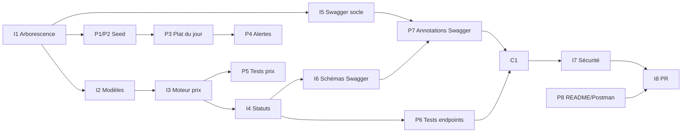

# Répartition des Tâches Backend — Ibrahima & Pathé

> **Branche de travail** : `feature/backend/setup-and-pricing`
> **Règle** : aucun `push` sans demande explicite d'Ibrahima.
> **Documentation** : chaque tâche est documentée dans [`docs_backend/`](docs_backend/README.md) (journaux [Ibrahima](docs_backend/journal_ibrahima.md) et [Pathé](docs_backend/journal_pathe.md)). Une tâche n'est « terminée » que lorsque sa fiche est rédigée.
> **Sous-branches conseillées** : `feature/backend/<nom-tache>` (voir guide de collaboration).

Légende : 🔴 prioritaire · 🟠 important · 🟢 finition

---

## 👤 Ibrahima Khalilou Diallo — Architecture, Moteur de Prix, Sécurité, Swagger (socle)

| ID | Priorité | Tâche | Livrable / Critère de validation |
|----|----------|-------|----------------------------------|
| I1 | 🔴 | **Aligner l'arborescence** sur le guide (`backend/api/`, `backend/bmc_backend/`, `backend/manage.py`) en intégrant `origin/feature/backend/fix-project-layout` | `python backend/manage.py runserver` démarre ; plus de dossier `api/api` |
| I2 | 🔴 | **B1 – Revue des modèles** : `payment_status` avec `choices` (`unpaid`/`pending`/`paid`), index sur `is_notified_to_admin`, contraintes de cohérence | Migration propre, sans conflit |
| I3 | 🔴 | **B2 – Durcir le moteur de prix** : fusion des lignes en doublon, quantité maximale, référence `BMC-XXXX` sans risque de collision, erreurs 400 explicites | Le client ne peut jamais influencer le prix |
| I4 | 🔴 | **Cycle de vie des statuts** : transitions autorisées `pending → confirmed → preparing → delivering → delivered` (+ `cancelled`) dans `OrderStatusUpdateView`, validation de `payment_status` | Transition invalide → 400 clair |
| I5 | 🔴 | **Swagger – socle** : installer et configurer `drf-spectacular` (`requirements.txt`, `INSTALLED_APPS`, `DEFAULT_SCHEMA_CLASS`, `SPECTACULAR_SETTINGS` : titre, description, version) | `GET /api/schema/` (OpenAPI), `GET /api/docs/` (Swagger UI), `GET /api/redoc/` |
| I6 | 🟠 | **Swagger – schémas des requêtes/réponses** : serializers explicites pour les réponses enveloppées (`success`, `orders`, `errors`…) et le payload `OrderCreate` | Swagger affiche des modèles corrects |
| I7 | 🟠 | **Sécurité** : `SECRET_KEY`, `DEBUG`, `ALLOWED_HOSTS`, CORS via variables d'environnement ; protéger les endpoints admin (liste commandes, toggle, statut, acquittement) | Aucun secret en dur ; endpoints admin non publics |
| I8 | 🟢 | **Revue croisée + PR** vers `develop` (reviewer : Lansana Coly) | PR validée |
| I9 | 🟠 | **Documenter I1 à I8** dans `docs/docs_backend/journal_ibrahima.md` (fiche par tâche, comment tester) | Journal à jour, cases « Documentée » cochées |

---

## 👤 Pathé Fall — Données, Endpoints d'Alerte, Documentation d'API, Tests

| ID | Priorité | Tâche | Livrable / Critère de validation |
|----|----------|-------|----------------------------------|
| P1 | 🔴 | **B3 – Audit du `seed_bmc`** : 32 articles, **7 catégories**, sauces (Fromagère, Samouraï, Algérienne, Barbecue…), prix exacts du menu `.docx`, plat du jour | `python manage.py seed_bmc` complet |
| P2 | 🔴 | **Seed idempotent** (relançable sans doublons) + base `bmc_orders.sqlite3` pré-remplie (décision de livraison à valider avec Ibrahima, le `.gitignore` ignore `*.sqlite3`) | Base prête pour la démo |
| P3 | 🔴 | **Plat du Jour** : toggle avec booléen strict (`"false"` ≠ vrai), réponse 400 si valeur invalide, gestion du ou des plats du jour | `PATCH /api/daily-special/<id>/toggle/` fiable |
| P4 | 🔴 | **Endpoint d'alertes** `/api/orders/events/unnotified/` : GET (commandes non notifiées) et POST (acquittement, `order_refs` inconnus gérés) | Utilisable par l'app admin (sonnerie + push) |
| P5 | 🔴 | **Tests unitaires du prix infalsifiable** : prix envoyé par le client ignoré, article indisponible, code inconnu, panier vide, quantité invalide, total correct | Tests verts |
| P6 | 🟠 | **Tests des endpoints** : tous les endpoints B4, cas 200/201/400/404, filtre `?status=` | Couverture de tous les endpoints |
| P7 | 🟠 | **Swagger – annotations** : `@extend_schema` sur chaque vue (summary, description en français, tags `Menu`, `Commandes`, `Admin`, paramètres `status`, exemples de payload, codes 400/404) | Chaque endpoint documenté et testable depuis `/api/docs/` |
| P8 | 🟢 | **Collection Postman/curl** + **`backend/README.md`** (installation, `migrate`, `seed_bmc`, lancement, lien Swagger) | Un coéquipier démarre le backend en suivant le README |
| P9 | 🟠 | **Documenter P1 à P8** dans `docs/docs_backend/journal_pathe.md` (fiche par tâche, comment tester) | Journal à jour, cases « Documentée » cochées |

---

## 🤝 Tâches communes

| ID | Tâche |
|----|-------|
| C1 | Valider que le schéma Swagger correspond exactement aux réponses réelles (Ibrahima : structure ; Pathé : exemples) |
| C2 | Revue croisée du code de l'autre avant la PR |
| C3 | Vérification finale avec la grille d'audit de `pilotage_et_audits_lead_technique.md` |
| C4 | Maintenir `docs/docs_backend/` : index à jour, journaux complets avant la PR |

---

## 🗓️ Ordre d'exécution conseillé

> [!NOTE]
> **Dépendances Swagger** : Ibrahima installe `drf-spectacular` (I5) et définit les serializers de réponse (I6). Pathé annote ensuite les vues (P7). Les vues étant des `APIView`, chaque endpoint a besoin d'un serializer déclaré pour que Swagger affiche les bons schémas.
