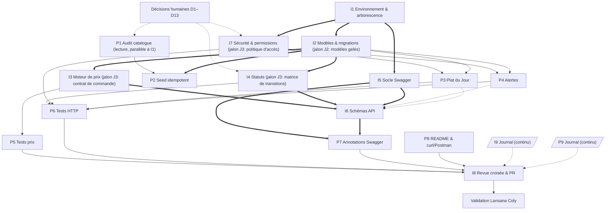

# Répartition des Tâches Backend — Ibrahima & Pathé

> **Document de référence de la répartition** (version 2 — audit de planification).
> Les spécifications métier restent dans [feuille_de_route_backend.md](feuille_de_route_backend.md) (chantiers B1–B4) ; les critères d'audit du Lead dans [pilotage_et_audits_lead_technique.md](pilotage_et_audits_lead_technique.md) ; le processus Git dans [guide_collaboration_github.md](guide_collaboration_github.md).
> Suivi individuel : [journal_ibrahima.md](docs_backend/journal_ibrahima.md) · [journal_pathe.md](docs_backend/journal_pathe.md) · index : [docs_backend/README.md](docs_backend/README.md).

| | |
|---|---|
| **Branche de travail** | `feature/backend/setup-and-pricing` |
| **Règle Git** | Aucun `push` sans demande explicite d'Ibrahima. Pas de `push --force`. PR vers `develop` (jamais `main`), reviewer : Lansana Coly. |
| **Situation de départ** | **Aucune tâche I1–I9 / P1–P9 n'a été exécutée.** |

> [!IMPORTANT]
> **Le code présent dans le dépôt ne prouve aucune tâche réalisée.** Les modèles, vues, serializers, `seed_bmc.py` et migrations viennent du squelette initial (commit `fef971e`). Ils constituent une **base à auditer**, pas un livrable d'Ibrahima ou de Pathé. Aucun test automatisé n'existe dans le dépôt.
> Ne jamais confondre : *fichier présent* ≠ *code existant* ≠ *tâche exécutée par son responsable* ≠ *tâche testée* ≠ *tâche validée par revue*.

---

## 0. Règles de suivi

### Statuts (cycle de vie d'une tâche)
`À faire` → `En cours` → `À tester` → `En revue` → `Validée`

| Statut | Condition d'entrée |
|---|---|
| À faire | Statut initial de **toutes** les tâches. |
| En cours | Le responsable a commencé l'exécution. |
| À tester | Livrable produit ; preuves de test pas encore fournies. |
| En revue | Preuves fournies ; relecture croisée en cours. |
| Validée | Tous les critères d'acceptation vérifiés **et** preuves consignées dans le journal **et** revue croisée faite. |

Une tâche ne peut passer à `Validée` qu'après exécution et vérification de **tous** ses critères d'acceptation.

### Rôles (par tâche)
- **Responsable** : implémente et livre. La propriété **ne se transfère jamais** à l'autre développeur.
- **Testeur / preuves** : celui qui écrit les tests ou fournit les preuves (peut être l'autre développeur, voir interfaces).
- **Relecteur croisé** : l'autre développeur (Ibrahima relit Pathé, Pathé relit Ibrahima). Il relit, il ne ré-implémente pas.
- **Validation finale** : Lansana Coly (Lead Technique), conformément au guide de collaboration.

### Planification vs exécution
Les documents de planification (ce fichier, journaux vierges, index) ont été **rédigés avant le développement**. Cela ne vaut **exécution d'aucune tâche**. Pour I9 et P9 : la création initiale des journaux est du *travail de planification* ; la tâche elle-même (tenir le journal à jour pendant tout le projet) est **À faire**.

### Chemins de fichiers
- Sur la branche actuelle, le projet est imbriqué (`backend/api/api/…`, `manage.py` à la racine).
- La structure cible, confirmée par le guide de collaboration et par `origin/feature/backend/fix-project-layout`, est : `backend/api/`, `backend/bmc_backend/`, `backend/manage.py`, `backend/requirements.txt`.
- **Les chemins ci-dessous sont les chemins cibles (après I1).** Un fichier marqué *(à créer)* n'existe pas encore ; son emplacement est une proposition à confirmer (décision D9).

---

## 1. Interfaces entre tâches (qui fait quoi, sans chevauchement)

| Objectif partagé | Implémente (propriétaire) | Teste / documente | Interface = livrable à fournir avant |
|---|---|---|---|
| Moteur de prix | **I3** (Ibrahima) | **P5** (Pathé) | I3 publie le **contrat de commande** : payload accepté, règles (quantité min/max, doublons), **codes et format d'erreur**. P5 écrit les tests contre ce contrat. |
| Statuts de commande | **I4** (Ibrahima) | **P6** (Pathé) | I4 publie la **matrice de transitions** et la liste des `payment_status`. P6 teste chaque transition. |
| Swagger | **I5 + I6** (Ibrahima) : socle + schémas | **P7** (Pathé) : annotations métier | I5 expose `/api/schema/` ; I6 fournit les serializers de requête/réponse. P7 annote les vues **sans modifier la logique**. |
| Modèles & données | **I2** (Ibrahima) | **P2** (Pathé) respecte | I2 déclare les **modèles gelés** (jalon J2). P2 n'altère aucun modèle ; toute demande de changement passe par Ibrahima. |
| Catalogue | **P1** (données) puis **P2** (mécanique) — Pathé | Ibrahima relit | P1 fixe le contenu du catalogue ; P2 la commande `seed_bmc` (idempotence, stratégie de base). |
| Alertes de commandes | **P4** (Pathé) | **P6** teste | I7 fournit la **politique de permissions** ; I6 fournit le schéma de réponse de `unnotified`. P4 les applique sans les redéfinir. |
| Sécurité / permissions | **I7** (Ibrahima) | **P6** teste 401/403 | I7 publie la **politique d'accès** (quel endpoint est public/admin) et les classes de permission. P3, P4 les appliquent. |
| Revue croisée | **I8** (Ibrahima) / **P9** (Pathé) | — | Chacun relit l'autre via checklist ; aucun transfert de propriété. |

### Lacunes comblées (endpoints sans propriétaire dans la feuille de route)
Ces attributions sont **proposées** pour qu'aucun endpoint ne reste orphelin — à confirmer (D11) :
- `GET /api/health/` → **I1** (preuve que le socle démarre).
- `GET /api/menu/` (format, filtrage `is_available`) → **P1** (conformité du menu).
- `GET /api/orders/` (liste, filtre `?status=`) et `GET /api/orders/<ref>/` (détail, 404) → **I4** (gestion des commandes).
- `POST /api/orders/` → **I3**.
- `PATCH /api/orders/<ref>/status/` → **I4**.
- `GET /api/daily-special/` et `PATCH /api/daily-special/<id>/toggle/` → **P3**.
- `GET`/`POST /api/orders/events/unnotified/` → **P4**.

---

## 2. Dépendances & ordre logique

Dépendance **dure** = livrable indispensable avant de commencer l'exécution. Dépendance **souple** = peut démarrer en parallèle (rédaction, préparation) mais ne peut être validée qu'après.

### Phases
| Phase | Contenu | Parallélisable |
|---|---|---|
| **0 — Décisions** | Trancher D1–D13 (section 6). | — |
| **1 — Socle** | **I1**. En parallèle, **P1** (lecture seule du seed et du menu `.docx`, rédaction du rapport d'écarts). | I1 ‖ P1 |
| **2 — Modèles** | **I2** → jalon **J2 « modèles gelés »**. | P1 continue |
| **3 — Contrats** | Contrats d'I3 (commande), I4 (transitions), I7 (accès), socle I5. | I3 ‖ I4 ‖ I5 ‖ I7 ; P2 démarre dès J2 |
| **4 — Implémentation** | Ibrahima : I3, I4, I6, I7. Pathé : P2, P3, P4 (dès que I7 a publié la politique d'accès). | Ibrahima ‖ Pathé |
| **5 — Tests** | **P5** (après contrat I3), **P6** (après I4, I7, P3, P4). Rédaction des cas possible dès le contrat. | P5 ‖ P6 |
| **6 — Documentation** | **P7** (après I5 + I6), **P8** (après stabilisation), journaux **I9/P9** (continus). **C1** : cohérence Swagger/réponses réelles. | P7 ‖ P8 |
| **7 — Revue & validation** | **I8**, **C2**, **C3**, validation Lansana Coly. | — |

### Dépendances critiques
1. **I1 bloque toute exécution de code** (migrations, tests, serveur).
2. **J2 (modèles gelés) bloque P2** (seed finalisé) et la finalisation de P3/P4.
3. **Contrat I3 bloque P5** ; **matrice I4 bloque P6 (statuts)**.
4. **Politique d'accès I7 (dépend de D1) bloque P3, P4 (câblage des permissions) et P6 (tests 401/403).**
5. **I5 + I6 bloquent P7** (les vues sont des `APIView` : sans serializers déclarés, Swagger ne produit pas de schéma exploitable).
6. **D3 (sauces) bloque P1/P2** ; **D2 (cycle de vie) bloque I4**.

---

## 3. Fiches — Ibrahima Khalilou Diallo

### I1 — Alignement de l'arborescence et du socle Django
- **Responsable** : Ibrahima. **Relecteur** : Pathé.
- **Objectif** : obtenir un projet Django qui démarre depuis la structure cible du guide, sans régression.
- **Périmètre** : arborescence `backend/api/`, `backend/bmc_backend/`, `backend/manage.py`, `backend/requirements.txt` ; vérification de l'environnement (version Python, dépendances de `requirements.txt`) ; démarrage du serveur ; `GET /api/health/` ; stratégie d'intégration de `origin/feature/backend/fix-project-layout` (D8).
- **Dépendances** : aucune.
- **Livrables** : structure alignée (confirmée par `origin/feature/backend/fix-project-layout`) ; `backend/manage.py` unique ; plus de dossier `backend/api/api/` ni de `manage.py` à la racine.
- **Cas d'erreur à traiter** : imports cassés après déplacement (`api.apps.ApiConfig`, `ROOT_URLCONF`, `WSGI_APPLICATION`) ; chemin de la base SQLite (`BASE_DIR`) ; version de Python différente de la 3.13 demandée ; migrations déplacées sans perte d'historique.
- **Tests et preuves** : sortie de `python backend/manage.py check` (0 erreur) ; `migrate` sur base vide sans erreur ; `runserver` démarre ; capture de `GET /api/health/` → 200.
- **Critères d'acceptation** : (1) arborescence conforme au guide ; (2) `check` sans erreur ; (3) `makemigrations --check --dry-run` → « No changes detected » ; (4) `/api/health/` → 200 JSON ; (5) aucun fichier supprimé sans équivalent dans la nouvelle structure ; (6) version Python utilisée consignée.
- **Hors périmètre** : modification des modèles, de la logique des vues, de la sécurité, de Swagger.
- **Statut initial** : À faire.

### I2 — Modèles, contraintes et migrations
- **Responsable** : Ibrahima. **Relecteur** : Pathé.
- **Objectif** : modèles `Category`, `MenuItem`, `Order`, `OrderItem` conformes au chantier B1, avec contraintes et migrations cohérentes ; produire le jalon **J2 (modèles gelés)**.
- **Périmètre** : `backend/api/models.py`, `backend/api/migrations/`, `backend/api/admin.py` (si adapté). Audit de conformité à B1 ; `payment_status` avec choix (`unpaid`, `pending`, `paid`) ; contraintes (prix ≥ 0, quantité ≥ 1, unicité `code` et `order_ref`) ; évaluation d'un index sur `is_notified_to_admin` ; cohérence `OrderItem` (`PROTECT`, copie `item_name`/`unit_price`).
- **Dépendances** : I1.
- **Livrables** : modèles validés ; migration(s) propres ; liste des champs « gelés » communiquée à Pathé.
- **Cas d'erreur** : migration sur base vide ET sur base déjà remplie ; migration non réversible ; incohérence entre `choices` et valeurs en base ; conflit de migrations.
- **Tests et preuves** : `makemigrations --check --dry-run` → « No changes detected » ; `migrate` sur base vide et sur copie d'une base remplie ; `python backend/manage.py check`.
- **Critères d'acceptation** : (1) tous les champs de B1 présents ; (2) pas de migration en conflit ; (3) contraintes vérifiées par au moins un essai de violation ; (4) jalon J2 annoncé dans le journal.
- **Hors périmètre** : contenu du catalogue (P1/P2), logique de calcul (I3), règles de transition (I4).
- **Statut initial** : À faire.

### I3 — Moteur de prix, validation du panier, références de commande
- **Responsable** : Ibrahima. **Testeur/preuves** : Pathé (P5). **Relecteur** : Pathé.
- **Objectif** : recalcul 100 % serveur du montant ; impossibilité pour le client d'influencer un prix (chantier B2).
- **Périmètre** : `OrderCreateSerializer` dans `backend/api/serializers.py` ; `POST /api/orders/` dans `backend/api/views.py`. Existence/disponibilité des articles, prix officiel lu en base, `subtotal`/`total_amount`, `transaction.atomic()`, validation de quantité (min et **max à décider**, D12), traitement des lignes en doublon, **unicité de `BMC-XXXX` y compris sous concurrence** (collision, réessai), validation des champs client (nom, téléphone, adresse), refus de tout champ de prix envoyé par le client.
- **Dépendances** : I1, I2.
- **Livrables** : **contrat de commande** (payload accepté, règles, codes et messages d'erreur) remis à Pathé ; moteur durci.
- **Cas d'erreur** : panier vide ; article inconnu ; article `is_available=False` ; quantité 0, négative, non entière, excessive ; identifiants en doublon ; champ `price`/`unit_price` envoyé par le client (ignoré ou refusé — à consigner) ; collision de référence ; échec en cours de création (rollback complet) ; payload mal formé.
- **Tests et preuves** : preuves fournies via les tests de **P5** (tests rédigés par Pathé) ; en complément, exemples de requêtes/réponses consignés dans le journal.
- **Critères d'acceptation** : (1) `total_amount` toujours égal à Σ(prix en base × quantité) ; (2) un prix envoyé par le client n'a aucun effet ; (3) toute entrée invalide → HTTP 400 avec message clair, aucune commande créée ; (4) création atomique (aucune ligne orpheline) ; (5) référence unique garantie même en cas de collision simulée ; (6) contrat publié.
- **Hors périmètre** : écriture des tests (P5), statuts (I4), annotations Swagger (P7), intégration réelle Wave/Orange Money.
- **Statut initial** : À faire.

### I4 — Transitions de commande et statuts de paiement
- **Responsable** : Ibrahima. **Testeur** : Pathé (P6). **Relecteur** : Pathé.
- **Objectif** : imposer un cycle de vie de commande cohérent et valider `payment_status`.
- **Périmètre** : `OrderStatusUpdateView` ; `GET /api/orders/` (filtre `?status=` validé) et `GET /api/orders/<ref>/` (404 clair) ; matrice de transitions autorisées (dépend de **D2** : présence de `confirmed`, retours arrière, annulation) ; valeurs autorisées de `payment_status` et qui peut les modifier (D6).
- **Dépendances** : I1, I2 ; D2, D6.
- **Livrables** : **matrice de transitions** et table des `payment_status` publiées ; vues conformes.
- **Cas d'erreur** : statut inconnu ; transition interdite (ex. `delivered` → `pending`) ; modification d'une commande `cancelled`/`delivered` ; `payment_status` invalide ; référence inexistante (404) ; filtre `?status=` inconnu ; corps vide.
- **Tests et preuves** : tests HTTP de **P6** couvrant chaque transition valide et au moins une invalide par état.
- **Critères d'acceptation** : (1) toute transition hors matrice → 400 avec message explicite listant les valeurs permises ; (2) transitions valides → 200 et état persistant ; (3) `payment_status` hors liste → 400 ; (4) référence inconnue → 404 ; (5) matrice conforme au critère d'audit du pilotage (**sous réserve de D2**).
- **Hors périmètre** : écriture des tests (P6), permissions (I7), notifications (P4).
- **Statut initial** : À faire.

### I5 — Socle Swagger / OpenAPI
- **Responsable** : Ibrahima. **Relecteur** : Pathé.
- **Objectif** : exposer le schéma OpenAPI et l'interface Swagger.
- **Périmètre** : configuration de la génération de schéma (outil proposé : `drf-spectacular`, **à confirmer par Ibrahima**), `requirements.txt`, `backend/bmc_backend/settings.py`, `backend/bmc_backend/urls.py` ; métadonnées (titre, description, version).
- **Dépendances** : I1.
- **Livrables** : routes de schéma et de documentation interactive ; dépendance déclarée.
- **Cas d'erreur** : génération du schéma avec avertissements/erreurs ; routes de doc exposées en production sans contrôle (voir I7) ; incompatibilité de versions Django/DRF.
- **Tests et preuves** : le schéma se génère sans erreur (commande de génération ou accès à la route) ; page Swagger accessible.
- **Critères d'acceptation** : (1) schéma OpenAPI valide servi ; (2) page Swagger affiche les endpoints existants ; (3) aucune erreur bloquante de génération ; (4) dépendance ajoutée à `requirements.txt`.
- **Hors périmètre** : annotations par endpoint (P7), définition des schémas métier détaillés (I6).
- **Statut initial** : À faire.

### I6 — Schémas de requêtes et réponses API
- **Responsable** : Ibrahima. **Relecteur** : Pathé.
- **Objectif** : contrats d'API explicites et cohérents avec les réponses réelles.
- **Périmètre** : `backend/api/serializers.py` (serializers de requête/réponse), format d'enveloppe des réponses (`success`, `errors`, `orders`…), **format d'erreur unifié** (400/404, D10), schémas pour `POST /api/orders/`, `unnotified`, `toggle`, liste/détail.
- **Dépendances** : I3, I4, I5 (souple : P3, P4 pour les schémas de leurs endpoints — Ibrahima définit le schéma commun, Pathé définit le contenu métier de ses réponses).
- **Livrables** : serializers de réponse déclarés ; document de contrat d'erreur.
- **Cas d'erreur** : divergence entre schéma et réponse réelle ; formats d'erreur incohérents (`error` vs `errors` vs `detail`) ; champs optionnels non déclarés.
- **Tests et preuves** : **C1** — comparaison d'un échantillon de réponses réelles avec le schéma, par endpoint.
- **Critères d'acceptation** : (1) chaque endpoint du chantier B4 a un schéma de requête et de réponse ; (2) les erreurs 400/404 suivent un format unique documenté ; (3) C1 sans écart.
- **Hors périmètre** : textes, tags et exemples d'endpoints (P7) ; logique métier des endpoints de Pathé.
- **Statut initial** : À faire.

### I7 — Sécurité, configuration sensible et contrôle d'accès
- **Responsable** : Ibrahima. **Testeur** : Pathé (P6, tests 401/403). **Relecteur** : Pathé.
- **Objectif** : aucun secret en dur ; endpoints d'administration non publics ; configuration dev/prod séparée.
- **Périmètre** : `backend/bmc_backend/settings.py` — `SECRET_KEY`, `DEBUG`, `ALLOWED_HOSTS`, CORS (`CORS_ALLOW_ALL_ORIGINS`), classe de permission par défaut (actuellement ouverte à tous) ; politique d'accès par endpoint ; mécanisme d'authentification admin (**D1**, non défini dans les documents) ; exposition des routes Swagger.
- **Dépendances** : I1 ; **D1**.
- **Livrables** : **politique d'accès** (tableau endpoint → public/admin) ; classes de permission réutilisables par P3/P4 ; variables d'environnement documentées (liste transmise à P8).
- **Cas d'erreur** : variable d'environnement absente (échec explicite plutôt que valeur par défaut dangereuse) ; accès sans authentification (401) ; accès avec mauvais droits (403) ; origine CORS non autorisée.
- **Tests et preuves** : tests de **P6** (anonyme → 401/403 sur endpoints admin ; public → 200 sur menu/commande) ; revue du dépôt : recherche de secrets en dur.
- **Critères d'acceptation** : (1) aucun secret dans le code ni dans l'historique des nouveaux commits ; (2) `DEBUG`, hôtes, CORS pilotés par l'environnement ; (3) endpoints admin refusés aux anonymes ; (4) endpoints publics (menu, health, création de commande, suivi par référence **à confirmer**) restent accessibles ; (5) politique d'accès publiée avant le câblage de P3/P4.
- **Hors périmètre** : logique métier des endpoints de Pathé ; écriture des tests ; gestion de comptes utilisateurs avancée.
- **Statut initial** : À faire.

### I8 — Revue croisée, préparation de PR et intégration
- **Responsable** : Ibrahima. **Validation finale** : Lansana Coly.
- **Objectif** : relire le travail de Pathé et préparer l'intégration selon le processus du projet — **sans reprendre la propriété** de ses tâches.
- **Périmètre** : checklist de relecture de P1–P9 ; vérification de la grille d'audit backend (pilotage) ; PR vers `develop` ; consignation des retours.
- **Dépendances** : toutes les tâches de développement au statut `En revue` ; P9.
- **Livrables** : compte rendu de relecture dans le journal ; PR (titre, description, tests exécutés) ; reviewer : Lansana Coly.
- **Cas d'erreur** : démarrage cassé (`runserver`) ; migrations en conflit avec `develop` ; tests rouges ; conflit Git (→ contacter Lansana, pas de manipulation destructrice) ; `push --force` interdit.
- **Tests et preuves** : exécution de la suite de tests, `check`, `makemigrations --check`, démarrage du serveur — sorties consignées.
- **Critères d'acceptation** : (1) toutes les tâches de Pathé relues avec retours consignés ; (2) PR ouverte vers `develop` ; (3) vérifications ci-dessus au vert ; (4) **aucun push sans demande explicite d'Ibrahima**.
- **Hors périmètre** : correction à la place de Pathé ; fusion dans `main` (réservée à Lansana).
- **Statut initial** : À faire.

### I9 — Tenue du journal de suivi personnel
- **Responsable** : Ibrahima. **Relecteur** : Pathé (lecture croisée via I8/P9).
- **Objectif** : tracer l'exécution réelle, les preuves et les décisions d'Ibrahima.
- **Périmètre** : [journal_ibrahima.md](docs_backend/journal_ibrahima.md) — **uniquement** les tâches I1–I9.
- **Dépendances** : continu, démarre avec I1.
- **Livrables** : une fiche par tâche renseignée (date, commit, fichiers modifiés, décisions, commande de test, preuves, limites).
- **Cas d'erreur** : statut modifié sans preuve ; fiche rédigée avant exécution ; tâches de Pathé consignées dans ce journal.
- **Tests et preuves** : cohérence statut ↔ preuves vérifiée par Pathé lors de la revue croisée.
- **Critères d'acceptation** : (1) statut à jour ; (2) aucun `Validée` sans preuves et revue ; (3) chaque fiche contient la commande pour reproduire le test.
- **Hors périmètre** : suivi des tâches de Pathé.
- **Statut initial** : À faire *(création du journal vierge = planification, déjà faite, non comptée)*.

---

## 4. Fiches — Pathé Fall

### P1 — Audit du catalogue et conformité du menu
- **Responsable** : Pathé. **Relecteur** : Ibrahima.
- **Objectif** : prouver (ou corriger) la conformité du catalogue avec le menu réel du restaurant.
- **Périmètre** : contenu de `backend/api/management/commands/seed_bmc.py` (données uniquement) comparé à `Projet BMC/Menu_BMC_FOOD_Noms_et_Prix.docx` ; rapport d'écarts ; catégories, noms, prix en F CFA, plat du jour ; format de `GET /api/menu/` (articles disponibles uniquement). **Sauces** : traitement selon **D3**.
- **Dépendances** : aucune pour l'audit (lecture) ; D3, D7 ; corrections finales après J2.
- **Livrables** : rapport d'audit (écarts catalogue ↔ menu) dans le journal ; données du seed conformes.
- **Cas d'erreur** : prix ou nom divergent du `.docx` ; article manquant ou en trop ; doublon de `code` ; catégorie mal rattachée ; contradiction « 32 articles / 7 catégories » vs sauces (D3).
- **Tests et preuves** : tableau article par article (source `.docx` ↔ base) ; comptage des articles et catégories après seed.
- **Critères d'acceptation** : (1) 0 écart non justifié avec le menu officiel ; (2) nombre d'articles et de catégories égal à la cible décidée en D3 ; (3) codes uniques ; (4) `GET /api/menu/` ne renvoie que les articles disponibles.
- **Hors périmètre** : mécanique d'exécution du seed (P2) ; modification des modèles (I2).
- **Statut initial** : À faire.

### P2 — Seed idempotent et stratégie de remplissage initial
- **Responsable** : Pathé. **Relecteur** : Ibrahima.
- **Objectif** : `python backend/manage.py seed_bmc` relançable sans doublons ni effet de bord ; stratégie claire pour la base de démo.
- **Périmètre** : `seed_bmc.py` (mécanique) ; décision sur la base SQLite pré-remplie (**D4** : versionnée ou générée ; `.gitignore` ignore `*.sqlite3` et aucun fichier sqlite n'est suivi par Git) ; comportement vis-à-vis de données existantes (commandes déjà passées).
- **Dépendances** : **J2 (I2)**, P1 (contenu), I1.
- **Livrables** : commande idempotente ; procédure documentée pour obtenir la base de démo.
- **Cas d'erreur** : double exécution ; exécution sur base déjà modifiée à la main (prix changé) — écrasement ou préservation à décider ; article référencé par une `OrderItem` ; base absente.
- **Tests et preuves** : exécution deux fois de suite → mêmes comptes ; test automatisé ou script de vérification consigné.
- **Critères d'acceptation** : (1) 2 exécutions = 0 doublon ; (2) aucune commande existante supprimée ou altérée ; (3) stratégie D4 appliquée et documentée ; (4) aucun changement de modèle.
- **Hors périmètre** : changement de modèles, contenu du catalogue (P1), données de commandes factices.
- **Statut initial** : À faire.

### P3 — Plat du Jour : validation stricte et règles métier
- **Responsable** : Pathé. **Testeur** : P6. **Relecteur** : Ibrahima.
- **Objectif** : activer/désactiver le Plat du Jour de façon fiable (chantier B3/B4).
- **Périmètre** : `GET /api/daily-special/` et `PATCH /api/daily-special/<id>/toggle/` dans `backend/api/views.py`. Règles : booléen strict (le texte `"false"` ne doit pas valoir vrai), unicité ou pluralité du plat du jour (**D5**), article indisponible, comportement quand aucun plat n'est défini (le code actuel retombe sur un best-seller — à confirmer en D5). Permissions : appliquer celles d'I7 (le toggle est une action admin).
- **Dépendances** : I1, J2 ; politique d'accès I7 (câblage) ; D5.
- **Livrables** : endpoints conformes ; règles consignées.
- **Cas d'erreur** : valeur non booléenne (400) ; article inexistant (404) ; article `is_available=False` ; accès non autorisé (401/403) ; état incohérent (plusieurs plats si D5 = unique).
- **Tests et preuves** : cas couverts par P6 ; exemples curl consignés dans le journal.
- **Critères d'acceptation** : (1) toute valeur non booléenne → 400 ; (2) règle D5 respectée en base après chaque appel ; (3) `GET` renvoie exactement le(s) plat(s) attendu(s) ; (4) toggle refusé aux non-autorisés.
- **Hors périmètre** : définition des permissions (I7), schéma de réponse commun (I6).
- **Statut initial** : À faire.

### P4 — Alertes de commandes : endpoints et acquittement
- **Responsable** : Pathé. **Testeur** : P6. **Relecteur** : Ibrahima.
- **Objectif** : l'app admin peut lire les commandes non notifiées et les acquitter de façon fiable.
- **Périmètre** : `GET` et `POST /api/orders/events/unnotified/` dans `backend/api/views.py`. Règles d'acquittement : références fournies / aucune référence fournie (le code actuel acquitte **toutes** les commandes — à confirmer, D14), références inconnues, idempotence. Permissions : appliquer celles d'I7.
- **Dépendances** : I1, J2 ; politique d'accès I7 ; contrat de réponse I6.
- **Livrables** : endpoints conformes ; règles d'acquittement consignées.
- **Cas d'erreur** : `order_refs` mal formé (non liste) → 400 ; références inconnues ; double acquittement ; acquittement massif involontaire ; accès non autorisé.
- **Tests et preuves** : tests P6 ; scénario consigné : créer commande → GET la voit → POST acquitte → GET ne la voit plus.
- **Critères d'acceptation** : (1) commande créée visible dans `GET` jusqu'à acquittement ; (2) acquittement ciblé n'affecte que les références données ; (3) entrée invalide → 400 ; (4) comportement « sans références » conforme à D14 ; (5) endpoint non public.
- **Hors périmètre** : mécanisme de notification push/sonnerie côté frontend ; définition des permissions (I7).
- **Statut initial** : À faire.

### P5 — Tests du moteur de prix et des cas d'erreur
- **Responsable** : Pathé. **Relecteur** : Ibrahima. **Cible testée** : I3.
- **Objectif** : prouver par tests automatisés que le prix est infalsifiable.
- **Périmètre** : fichiers de tests *(à créer ; emplacement proposé `backend/api/tests/` ou `backend/api/tests.py`, D9)*. Aucun test n'existe actuellement.
- **Dépendances** : contrat I3 (rédaction possible dès sa publication) ; I1, I2. Validation après I3 exécuté.
- **Livrables** : suite de tests du moteur de prix, exécutable par une commande unique.
- **Cas à couvrir** : prix client ignoré/refusé ; total exact (cas multi-lignes) ; panier vide ; article inconnu ; article indisponible ; quantité 0/négative/non entière/au-delà du max (D12) ; doublons ; collision de référence ; atomicité (aucune commande partielle) ; aucune écriture en cas d'erreur.
- **Tests et preuves** : sortie de `python backend/manage.py test` (ou équivalent) consignée, tous verts.
- **Critères d'acceptation** : (1) chaque cas ci-dessus a au moins un test ; (2) tous les tests passent ; (3) un test échoue si le moteur lit un prix venant du client (preuve par essai négatif).
- **Hors périmètre** : correction du moteur (I3) ; tests des statuts (P6).
- **Statut initial** : À faire.

### P6 — Tests des endpoints et des réponses HTTP
- **Responsable** : Pathé. **Relecteur** : Ibrahima. **Cibles testées** : I3, I4, I7, P3, P4 et endpoints de lecture.
- **Objectif** : prouver codes HTTP, formats et permissions de tous les endpoints B4.
- **Périmètre** : tests HTTP *(à créer, D9)* : health, menu, daily-special (GET/toggle), orders (GET liste + filtre, POST, détail), status, unnotified (GET/POST).
- **Dépendances** : I3, I4, I7, P3, P4 ; matrice I4 ; politique d'accès I7.
- **Livrables** : suite de tests HTTP.
- **Cas à couvrir** : 200/201 nominal ; 400 (entrée invalide) ; 404 (référence/id inconnus) ; 401/403 (endpoints admin sans droits) ; chaque transition valide et au moins une invalide ; filtre `?status=` valide et invalide ; format d'erreur unifié (I6).
- **Tests et preuves** : sortie de la suite complète, tous verts ; tableau endpoint × code vérifié.
- **Critères d'acceptation** : (1) 100 % des endpoints du chantier B4 ont au moins un test nominal et un test d'erreur ; (2) permissions testées ; (3) suite verte.
- **Hors périmètre** : correction des vues (I3/I4/I7/P3/P4 selon propriétaire) ; tests du moteur de prix (P5).
- **Statut initial** : À faire.

### P7 — Annotations et documentation des endpoints dans Swagger
- **Responsable** : Pathé. **Relecteur** : Ibrahima.
- **Objectif** : chaque endpoint est compréhensible et testable depuis Swagger.
- **Périmètre** : annotations OpenAPI sur les vues (`backend/api/views.py`) : résumé et description en français, tags (ex. Menu, Commandes, Admin), paramètres (`status`), exemples de requêtes/réponses, codes 400/404/401/403. **Aucune modification de logique** ; les schémas sont ceux d'I6.
- **Dépendances** : I5, I6 ; politique d'accès I7 (pour les mentions d'authentification).
- **Livrables** : annotations sur 100 % des endpoints.
- **Cas d'erreur** : annotation en contradiction avec le comportement réel ; endpoint non documenté ; exemples invalides.
- **Tests et preuves** : **C1** — chaque exemple Swagger exécuté et conforme ; génération du schéma sans avertissement.
- **Critères d'acceptation** : (1) tous les endpoints B4 documentés ; (2) exemples exécutables et exacts ; (3) codes d'erreur listés ; (4) aucun changement de comportement (tests P5/P6 toujours verts).
- **Hors périmètre** : configuration du socle (I5), définition des schémas (I6).
- **Statut initial** : À faire.

### P8 — Documentation d'installation et exemples d'utilisation
- **Responsable** : Pathé. **Relecteur** : Ibrahima.
- **Objectif** : un coéquipier démarre le backend en suivant le guide, sans aide.
- **Périmètre** : `backend/README.md` *(à créer, D9)* : prérequis, installation des dépendances, variables d'environnement (liste fournie par I7), `migrate`, `seed_bmc`, lancement, lien vers Swagger, exécution des tests ; exemples curl ou collection Postman pour chaque endpoint.
- **Dépendances** : I1, I7 (variables), P2, I3/I4/P3/P4 stabilisés (exemples), I5 (lien Swagger).
- **Livrables** : README ; exemples curl/Postman.
- **Cas d'erreur** : étapes obsolètes après changement ; commandes non testées ; secrets réels dans les exemples.
- **Tests et preuves** : exécution du guide de bout en bout sur un environnement propre par Ibrahima (relecture) ; chaque exemple rejoué avec succès.
- **Critères d'acceptation** : (1) guide exécuté de zéro jusqu'à `GET /api/health/` sans intervention ; (2) tous les exemples rejouables ; (3) aucun secret réel.
- **Hors périmètre** : modification du code ; configuration de déploiement en production.
- **Statut initial** : À faire.

### P9 — Tenue du journal de suivi personnel
- **Responsable** : Pathé. **Relecteur** : Ibrahima (via I8).
- **Objectif** : tracer l'exécution réelle, les preuves et les décisions de Pathé.
- **Périmètre** : [journal_pathe.md](docs_backend/journal_pathe.md) — **uniquement** les tâches P1–P9.
- **Dépendances** : continu, démarre avec P1.
- **Livrables / Critères / Hors périmètre** : identiques à I9, appliqués aux tâches P1–P9 ; aucune tâche d'Ibrahima n'est consignée ici.
- **Statut initial** : À faire *(création du journal vierge = planification, déjà faite, non comptée)*.

---

## 5. Matrice des risques techniques

| Risque | Implémentation / traitement | Tests / preuves | Relecture |
|---|---|---|---|
| Permissions et authentification des endpoints admin | **I7** (politique) ; **P3, P4** appliquent | **P6** (401/403) | I8 / P9 |
| Secrets, dev/prod, CORS, hôtes autorisés | **I7** | revue du dépôt (I8) ; liste d'environnement dans P8 | Pathé |
| Validation du panier et recalcul serveur | **I3** | **P5** | Pathé |
| Unicité des références, concurrence | **I3** | **P5** (collision simulée) ; limites de SQLite à consigner | Pathé |
| Transitions de statut et statuts de paiement | **I4** (dépend D2, D6) | **P6** | Pathé |
| Validation stricte du Plat du Jour | **P3** | **P6** | Ibrahima |
| Acquittement des alertes | **P4** | **P6** | Ibrahima |
| Exactitude du catalogue, idempotence du seed | **P1**, **P2** | tableau d'audit P1 ; double exécution P2 | Ibrahima |
| Cohérence des migrations | **I2** (et I1 pour le déplacement) | `makemigrations --check`, `migrate` base vide/remplie ; revérifié par I8 | Pathé |
| Tests automatisés | **P5, P6** | exécution globale par I8 | Ibrahima |
| Conformité des réponses HTTP | **I6** (contrat) ; chaque propriétaire d'endpoint s'y conforme | **P6** | croisée |
| Documentation OpenAPI | **I5, I6** ; **P7** | **C1** | croisée |

---

## 6. Points nécessitant une décision humaine (non déductibles des documents)

| # | Décision | Bloque |
|---|---|---|
| D1 | **Mécanisme d'authentification des endpoints admin** (jeton, session, clé…). Aucun document ne le définit. | I7, P3, P4, P6 |
| D2 | **Cycle de vie des statuts** : `feuille_de_route_backend.md` et le modèle contiennent `confirmed` et `cancelled`, mais le critère d'audit de `pilotage_et_audits_lead_technique.md` cite seulement `pending → preparing → delivering → delivered`. Quelles transitions, retours arrière, annulation ? | I4, P6 |
| D3 | **Sauces** : demandées par la feuille de route (« Sauces associées »), absentes du seed actuel, alors que l'audit exige **32 articles et 7 catégories** (le seed en compte déjà 32 et 7). Articles à part entière, options, ou hors MVP ? | P1, P2 |
| D4 | **Base SQLite pré-remplie** : versionnée dans Git ou générée par `seed_bmc` ? (`.gitignore` ignore `*.sqlite3`.) | P2, P8 |
| D5 | **Plat du Jour** : un seul ou plusieurs ? Comportement du `GET` quand aucun n'est défini (le code retombe aujourd'hui sur un best-seller) ? | P3 |
| D6 | **Paiement Wave / Orange Money** : pas d'intégration réelle prévue ? Qui passe `payment_status` à `paid` (admin manuellement) ? | I4 |
| D7 | **Source de vérité du menu** : `Menu_BMC_FOOD_Noms_et_Prix.docx` (+ images `Projet BMC/`). Le `.docx` n'a pas été analysé dans cette mission. | P1 |
| D8 | **Intégration de la structure** : fusion, cherry-pick ou refonte de `feature/backend/fix-project-layout` (commit d'El Hadji, côté frontend) ? Branche unique ou sous-branches `feature/backend/<tâche>` ? | I1, I8 |
| D9 | **Emplacements** des tests (`backend/api/tests/` ou `tests.py`) et du `backend/README.md`. | P5, P6, P8 |
| D10 | **Format d'erreur unifié** (le code actuel mélange `error`, `errors`, `detail`). | I6, P6 |
| D11 | Confirmer l'attribution des **endpoints orphelins** (section 1). | I1, I4, P1 |
| D12 | **Quantité maximale** par ligne et taille maximale du panier. | I3, P5 |
| D13 | Version de **Python** de l'environnement local (la feuille de route demande 3.13). | I1 |
| D14 | **Acquittement sans références** : acquitter toutes les commandes (comportement actuel) ou refuser ? | P4 |

---

## 7. Tâches communes

| ID | Tâche | Qui | Preuve |
|----|-------|-----|--------|
| C1 | Vérifier que le schéma Swagger correspond aux réponses réelles | Ibrahima (structure, I6) + Pathé (exemples, P7) | Tableau endpoint × conformité dans les journaux |
| C2 | Revue croisée du code de l'autre | Chacun relit l'autre (I8 / P9) ; aucune propriété transférée | Compte rendu dans chaque journal |
| C3 | Vérification avec la grille d'audit backend de `pilotage_et_audits_lead_technique.md` | Les deux ; validation Lansana Coly | Grille cochée avec preuves |
| C4 | Maintenir `docs/docs_backend/` à jour avant la PR | Les deux (I9/P9) | Index et journaux cohérents avec ce document |

---

## 8. Hiérarchie documentaire (en cas de contradiction)

1. **Consignes du projet / Lead Technique** : [guide_collaboration_github.md](guide_collaboration_github.md), [pilotage_et_audits_lead_technique.md](pilotage_et_audits_lead_technique.md).
2. **Spécifications métier** : [feuille_de_route_backend.md](feuille_de_route_backend.md) (B1–B4).
3. **Répartition et suivi** : ce document, puis les journaux individuels.

Les contradictions relevées entre ces documents (notamment D2 et D3) ne sont **pas tranchées ici** : elles attendent une décision humaine.

---

## 9. Décisions tranchées par Ibrahima (21/10/2026)

| # | Décision retenue |
|---|---|
| D1 | Jeton DRF pour compte staff ; permission `IsAdminUser` sur les endpoints admin. |
| D2 | `pending → confirmed → preparing → delivering → delivered` ; `cancelled` depuis `pending`/`confirmed`/`preparing` ; sans saut ni retour ; `delivered` et `cancelled` finaux. |
| D6 | Paiement : `unpaid → pending → paid` et `unpaid → paid` ; `paid` final ; modifiable par l'administration uniquement ; pas d'intégration Wave/OM réelle. |
| D8 | Déplacements `git mv` refaits sur la branche (résultat identique à `fix-project-layout`). |
| D10 | Erreurs : `success:false` + `errors` (par champ) + `error` ; 404 harmonisés. |
| D12 | 20 unités maximum par ligne, 30 lignes distinctes maximum. |

Les autres décisions (D3, D4, D5, D7, D9, D11, D13, D14) restent ouvertes. Statuts réels des tâches d'Ibrahima : voir [journal_ibrahima.md](docs_backend/journal_ibrahima.md).
