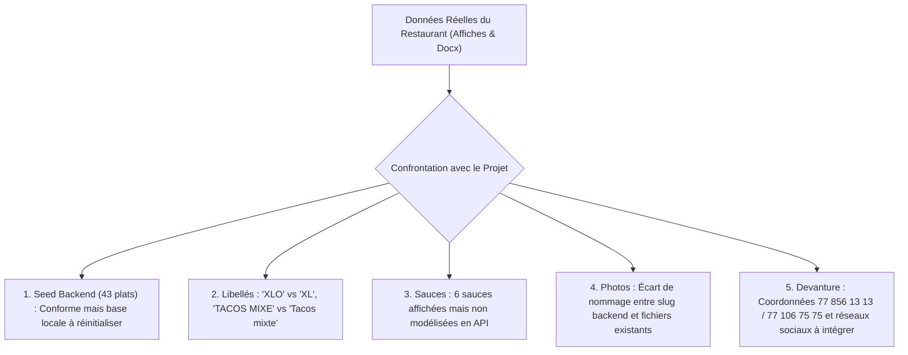

# Rapport d'Audit & Vérification des Données Métier BMC FOOD

> **Document de Référence** : `docs/verification_donnees_bmc.md`  
> **Date de réalisation** : 22 octobre 2026  
> **Auteur** : Pape Aliou Sène (Développeur Frontend — Panier, Commandes, Alertes Admin & Données Métier)  
> **Destinataires** : Pathé Fall (Backend), Maimouna Sall (Frontend & Assets), El Hadji Massogui Diop (Lead Frontend), Ibrahima Khalilou Diallo (Backend), Lansana Coly (Lead Technique)  
> **Statut** : Validé pour arbitrage & alignement d'équipe (Tâche 4)

---

## 1. Contexte et Objectifs de l'Audit

Cet audit a été mené pour confronter l'ensemble des données du projet **BMC FOOD** avec la réalité du restaurant physique à Dakar, et garantir une cohérence parfaite entre :
1. **Les panneaux de menu réels photographiés sur place** :
   - `Projet BMC/IMG_3227.PNG` (Tacos panés, Tacos jambon pané, Tacos Royal pané, Tacos Hot Dog pané, Tacos XLO pané) ;
   - `Projet BMC/IMG_3228.PNG` (Burgers complet, double, jambon, royal, coordonnées et engagements qualité) ;
   - `Projet BMC/IMG_3229.PNG` (Grille intégrale des 19 Tacos simples, sauces, pictogrammes) ;
   - `Projet BMC/099D05B3-D5DE-4DBB-B6C7-9B32B9411FC7.png` (Devanture officielle du restaurant : enseigne, numéros, réseaux sociaux).
2. **Le document compilé officiel** : `Projet BMC/Menu_BMC_FOOD_Noms_et_Prix.docx`.
3. **Le script de seed backend** : `backend/api/management/commands/seed_bmc.py` (branche `origin/feature/backend/pathe-fall`).
4. **Le catalogue d'assets visuels** : `client_website/public/images/products/` et les nouveaux visuels haute définition créés par Maimouna dans `docs/assets/products/` (commit `2f1f29b`).
5. **Le respect de l'identité de marque (Logo & Charte)** : vérification de l'intégrité visuelle du logo sur l'application client et l'application cuisine.

---

## 2. Synthèse Exécutive des Constats & Écarts

### Principaux points d'attention :
1. **Nombre d'articles au menu** :
   - Le seed initial ne comprenait que 32 articles (avec seulement 8 tacos simples).
   - Le seed récent de Pathé Fall (`origin/feature/backend/pathe-fall`) a bien intégré les **43 articles réels** (dont les 19 tacos simples `ts-1` à `ts-19`).
   - **Action requise** : Le serveur backend local tourne actuellement sur l'ancienne base à 32 articles. Il doit être re-seedé avec l'option `--reset` pour charger les 43 articles.
2. **Écart de dénomination « XLO » vs « XL »** :
   - Les panneaux physiques affichent en grand **« TACOS XLO PANÉ »** (6 000 F) et **« TACOS XLO SIMPLE »** (5 000 F).
   - Le seed et les maquettes utilisent **« Tacos XL pané »** et **« Tacos XL simple »**.
   - **Recommandation** : Conserver le slug `tacos-xl-pane` et `tacos-xl-simple` pour la compatibilité technique, mais afficher dans l'interface le libellé authentique **« Tacos XLO Pané »** et **« Tacos XLO Simple »** apprécié par la clientèle locale.
3. **Sauces d'accompagnement** :
   - Le panneau `IMG_3229.PNG` met en avant **6 sauces signature** : *Samouraï, Algérienne, Ketchup, Mayonnaise, Barbecue, Fromagère*.
   - Elles ne sont actuellement modélisées ni en base ni dans la commande client.
4. **Photos et convention de nommage** :
   - Le backend génère systématiquement l'`image_url` sous la forme `/images/products/<slugify(nom)>.webp` (ex: `/images/products/burger-complet.webp`).
   - Dans le frontend, plusieurs fichiers possèdent des préfixes différents (ex: `burger-bmc-complet.webp`) ou conservent des noms bruts d'exportation IA (ex: `Burger_Royal_on_slate_background_20261021171914.webp`).
   - Un plan de renommage exhaustif plat par plat est fourni en Section 4.

---

## 3. Comparatif Détaillé : Panneaux Menu vs Seed Backend

### 3.1. Tacos Panés (Spécialité Vedette BMC) — Affiche `IMG_3227.PNG`
| Code | Nom Panneau / Docx | Prix Panneau | Nom dans le Seed | Prix Seed | Statut & Écart |
| :--- | :--- | :---: | :--- | :---: | :--- |
| `tp-1` | Tacos viande pané | 3 500 F | Tacos viande pané | 3 500 F | **Conforme** |
| `tp-2` | Tacos poulet pané | 3 500 F | Tacos poulet pané | 3 500 F | **Conforme** |
| `tp-3` | Tacos mixte pané | 4 000 F | Tacos mixte pané | 4 000 F | **Conforme** |
| `tp-4` | Tacos jambon pané | 3 000 F | Tacos jambon pané | 3 000 F | **Conforme** (récemment rétabli dans le seed) |

### 3.2. Tacos Jambon Pané — Affiche `IMG_3227.PNG`
| Code | Nom Panneau / Docx | Prix Panneau | Nom dans le Seed | Prix Seed | Statut & Écart |
| :--- | :--- | :---: | :--- | :---: | :--- |
| `tjp-1` | Tacos viande jambon pané | 4 500 F | Tacos viande jambon pané | 4 500 F | **Conforme** |
| `tjp-2` | Tacos poulet jambon pané | 4 500 F | Tacos poulet jambon pané | 4 500 F | **Conforme** |
| `tjp-3` | Tacos mixte jambon pané | 5 000 F | Tacos mixte jambon pané | 5 000 F | **Conforme** |

### 3.3. Tacos Royal Pané — Affiche `IMG_3227.PNG`
| Code | Nom Panneau / Docx | Prix Panneau | Nom dans le Seed | Prix Seed | Statut & Écart |
| :--- | :--- | :---: | :--- | :---: | :--- |
| `trp-1` | Tacos viande jambon royal pané | 5 000 F | Tacos viande jambon royal pané | 5 000 F | **Conforme** |
| `trp-2` | Tacos poulet jambon royal pané | 5 000 F | Tacos poulet jambon royal pané | 5 000 F | **Conforme** |
| `trp-3` | Tacos mixte jambon royal pané | 6 000 F | Tacos mixte jambon royal pané | 6 000 F | **Conforme** — **Plat du Jour officiel** |
| `trp-4` | Tacos viande royal pané | 4 000 F | Tacos viande royal pané | 4 000 F | **Conforme** |
| `trp-5` | Tacos poulet royal pané | 4 000 F | Tacos poulet royal pané | 4 000 F | **Conforme** |
| `trp-6` | Tacos mixte royal pané | 4 500 F | Tacos mixte royal pané | 4 500 F | **Conforme** |

### 3.4. Tacos Hot Dog Pané — Affiche `IMG_3227.PNG`
| Code | Nom Panneau / Docx | Prix Panneau | Nom dans le Seed | Prix Seed | Statut & Écart |
| :--- | :--- | :---: | :--- | :---: | :--- |
| `thp-1` | Tacos viande hot dog pané | 4 500 F | Tacos viande hot dog pané | 4 500 F | **Conforme** |
| `thp-2` | Tacos poulet hot dog pané | 4 500 F | Tacos poulet hot dog pané | 4 500 F | **Conforme** |
| `thp-3` | Tacos mixte hot dog pané | 5 000 F | Tacos mixte hot dog pané | 5 000 F | **Conforme** |
| `thp-4` | Tacos viande hot dog royal pané | 5 000 F | Tacos viande hot dog royal pané | 5 000 F | **Conforme** |
| `thp-5` | Tacos poulet hot dog royal pané | 5 000 F | Tacos poulet hot dog royal pané | 5 000 F | **Conforme** |
| `thp-6` | Tacos mixte hot dog royal pané | 6 000 F | Tacos mixte hot dog royal pané | 6 000 F | **Conforme** |

### 3.5. Tacos XLO Pané — Affiche `IMG_3227.PNG`
| Code | Nom Panneau / Docx | Prix Panneau | Nom dans le Seed | Prix Seed | Statut & Écart |
| :--- | :--- | :---: | :--- | :---: | :--- |
| `txl-1` | **TACOS XLO PANÉ** | 6 000 F | Tacos XL pané | 6 000 F | **Écart de libellé** : le panneau écrit explicitement « XLO » |

### 3.6. Burgers — Affiche `IMG_3228.PNG`
| Code | Nom Panneau / Docx | Prix Panneau | Nom dans le Seed | Prix Seed | Statut & Écart |
| :--- | :--- | :---: | :--- | :---: | :--- |
| `bg-1` | Burger complet | 2 000 F | Burger complet | 2 000 F | **Conforme** |
| `bg-2` | Double burger | 2 500 F | Double burger | 2 500 F | **Conforme** |
| `bg-3` | Burger jambon | 2 500 F | Burger jambon | 2 500 F | **Conforme** |
| `bg-4` | Burger royal | 3 000 F | Burger royal | 3 000 F | **Conforme** |

> *Note orthographique* : Sur le panneau physique `IMG_3228.PNG`, le macaron indique *« Un Burger qui fait la Diférence ! »* (un seul 'f'). L'orthographe française correcte avec deux 'f' est bien respectée dans le code.

### 3.7. Tacos Simples (19 déclinaisons) — Affiche `IMG_3229.PNG`
| N° | Code | Nom Panneau Physique | Nom Seed Backend | Prix | Statut & Analyse |
| :---: | :--- | :--- | :--- | :---: | :--- |
| 1 | `ts-1` | Tacos viande | Tacos viande | 2 500 F | **Conforme** |
| 2 | `ts-2` | Tacos poulet | Tacos poulet | 2 500 F | **Conforme** |
| 3 | `ts-3` | TACOS MIXE | Tacos mixte | 3 000 F | Écrit « MIXE » sur affiche, « mixte » en seed (normalisé) |
| 4 | `ts-4` | Tacos jambon | Tacos jambon | 2 000 F | **Conforme** |
| 5 | `ts-5` | Tacos viande jambon | Tacos viande jambon | 3 500 F | **Conforme** |
| 6 | `ts-6` | Tacos poulet jambon | Tacos poulet jambon | 3 500 F | **Conforme** |
| 7 | `ts-7` | TACOS MIXE JAMBON | Tacos mixte jambon | 4 000 F | Écrit « MIXE » sur affiche, « mixte » en seed |
| 8 | `ts-8` | Tacos viande jambon royal | Tacos viande jambon royal | 4 000 F | **Conforme** |
| 9 | `ts-9` | Tacos poulet jambon royal | Tacos poulet jambon royal | 4 000 F | **Conforme** |
| 10 | `ts-10` | TACOS MIXE JAMBON ROYAL | Tacos mixte jambon royal | 5 000 F | Écrit « MIXE » sur affiche, « mixte » en seed |
| 11 | `ts-11` | Tacos viande royal | Tacos viande royal | 3 000 F | **Conforme** |
| 12 | `ts-12` | Tacos poulet royal | Tacos poulet royal | 3 000 F | **Conforme** |
| 13 | `ts-13` | TACOS MIXE ROYAL | Tacos mixte royal | 3 500 F | Écrit « MIXE » sur affiche, « mixte » en seed |
| 14 | `ts-14` | Tacos viande hot dog | Tacos viande hot dog | 3 500 F | **Conforme** |
| 15 | `ts-15` | Tacos poulet hot dog | Tacos poulet hot dog | 3 500 F | **Conforme** |
| 16 | `ts-16` | TACOS MIXE HOT DOG | Tacos mixte hot dog | 4 000 F | Écrit « MIXE » sur affiche, « mixte » en seed |
| 17 | `ts-17` | Tacos viande hot dog royal | Tacos viande hot dog royal | 4 500 F | **Conforme** |
| 18 | `ts-18` | Tacos poulet hot dog royal | Tacos poulet hot dog royal | 4 500 F | **Conforme** |
| 19 | `ts-19` | **TACOS XLO SIMPLE** | Tacos XL simple | 5 000 F | **Écart** : « XLO » sur affiche physique |

---

## 4. Audit Plat par Plat des Photos & Plan de Renommage

Le backend Django génère automatiquement l'URL de chaque image avec :
$$\text{image\_url} = \text{/images/products/} + \text{slugify}(\text{nom}) + \text{.webp}$$

Pour que toutes les images s'affichent sans rupture 404 sur le site et l'admin, les fichiers doivent être placés dans `client_website/public/images/products/` selon la table ci-dessous :

| Code | Catégorie | Nom Officiel | Prix | Image attendue (`image_url`) | Fichier source disponible | Action requise |
| :--- | :--- | :--- | :---: | :--- | :--- | :--- |
| `tp-1` | Tacos panés | **Tacos viande pané** | 3 500 F | `tacos-viande-pane.webp` | `tacos-viande-pane.webp` |  Prêt et conforme |
| `tp-2` | Tacos panés | **Tacos poulet pané** | 3 500 F | `tacos-poulet-pane.webp` | `Cut_French_Tacos_Poulet_Pané_20261021175420.webp` | Copier et renommer vers `public/` |
| `tp-3` | Tacos panés | **Tacos mixte pané** | 4 000 F | `tacos-mixte-pane.webp` | `tacos-mixte-pane.webp` |  Prêt et conforme |
| `tp-4` | Tacos panés | **Tacos jambon pané** | 3 000 F | `tacos-jambon-pane.webp` | `French_Tacos_Jambon_Pané_20261021161350.webp` | Copier et renommer vers `public/` |
| `tjp-1` | Tacos jambon pané | **Tacos viande jambon pané** | 4 500 F | `tacos-viande-jambon-pane.webp` | `French_Tacos_Jambon_Pané_sliced_20261021175946.webp` | Copier et renommer vers `public/` |
| `tjp-2` | Tacos jambon pané | **Tacos poulet jambon pané** | 4 500 F | `tacos-poulet-jambon-pane.webp` | `French_Tacos_Pané_sliced_diagonally_20261021175232.webp` | Copier et renommer vers `public/` |
| `tjp-3` | Tacos jambon pané | **Tacos mixte jambon pané** | 5 000 F | `tacos-mixte-jambon-pane.webp` | `French_Tacos_Mixte_sliced_20261021172716.webp` | Copier et renommer vers `public/` |
| `trp-1` | Tacos Royal pané | **Tacos viande jambon royal pané** | 5 000 F | `tacos-viande-jambon-royal-pane.webp` | `Toasted_Royal_Tacos_with_sauce_20261021173905.webp` | Copier et renommer vers `public/` |
| `trp-2` | Tacos Royal pané | **Tacos poulet jambon royal pané** | 5 000 F | `tacos-poulet-jambon-royal-pane.webp` | `French_tacos_sliced_on_slate_20261021175716.webp` | Copier et renommer vers `public/` |
| `trp-3` | Tacos Royal pané | **Tacos mixte jambon royal pané** | 6 000 F | `tacos-mixte-jambon-royal-pane.webp` | `French_Tacos_Mixte_with_sauces_20261021175851.webp` | **Plat du Jour** : Copier vers `public/` |
| `trp-4` | Tacos Royal pané | **Tacos viande royal pané** | 4 000 F | `tacos-viande-royal-pane.webp` | `French_tacos_sliced_with_sauces_20261021175219.webp` | Copier et renommer vers `public/` |
| `trp-5` | Tacos Royal pané | **Tacos poulet royal pané** | 4 000 F | `tacos-poulet-royal-pane.webp` | `French_tacos_served_with_fries_20261021172858.webp` | Copier et renommer vers `public/` |
| `trp-6` | Tacos Royal pané | **Tacos mixte royal pané** | 4 500 F | `tacos-mixte-royal-pane.webp` | `French_tacos_served_with_fries_20261021172906.webp` | Copier et renommer vers `public/` |
| `thp-1` | Tacos Hot Dog pané | **Tacos viande hot dog pané** | 4 500 F | `tacos-viande-hot-dog-pane.webp` | `French_tacos_cut_in_half_20261021174603.webp` | Copier et renommer vers `public/` |
| `thp-2` | Tacos Hot Dog pané | **Tacos poulet hot dog pané** | 4 500 F | `tacos-poulet-hot-dog-pane.webp` | `French_tacos_cut_in_half_20261021174717.webp` | Copier et renommer vers `public/` |
| `thp-3` | Tacos Hot Dog pané | **Tacos mixte hot dog pané** | 5 000 F | `tacos-mixte-hot-dog-pane.webp` | `French_tacos_cut_in_half_20261021174723.webp` | Copier et renommer vers `public/` |
| `thp-4` | Tacos Hot Dog pané | **Tacos viande hot dog royal pané** | 5 000 F | `tacos-viande-hot-dog-royal-pane.webp` | `Toasted_French_tacos_on_dark_20261021174441.webp` | Copier et renommer vers `public/` |
| `thp-5` | Tacos Hot Dog pané | **Tacos poulet hot dog royal pané** | 5 000 F | `tacos-poulet-hot-dog-royal-pane.webp` | `Grilled_French_tacos_with_filling_20261021174331.webp` | Copier et renommer vers `public/` |
| `thp-6` | Tacos Hot Dog pané | **Tacos mixte hot dog royal pané** | 6 000 F | `tacos-mixte-hot-dog-royal-pane.webp` | `Grilled_French_tacos_halved_with…_20261021174336.webp` | Copier et renommer vers `public/` |
| `txl-1` | Tacos XL pané | **Tacos XL pané** | 6 000 F | `tacos-xl-pane.webp` | `Large_taco_on_wood_20261021174801.webp` | Copier et renommer vers `public/` |
| `bg-1` | Burgers | **Burger complet** | 2 000 F | `burger-complet.webp` | `burger-bmc-complet.webp` | Renommer `burger-bmc-complet.webp` |
| `bg-2` | Burgers | **Double burger** | 2 500 F | `double-burger.webp` | `Double_burger_with_barbecue_sauce_20261021170413.webp` | Copier et renommer vers `public/` |
| `bg-3` | Burgers | **Burger jambon** | 2 500 F | `burger-jambon.webp` | `Burger_with_cheese_and_meat_20261021171547.webp` | Copier et renommer vers `public/` |
| `bg-4` | Burgers | **Burger royal** | 3 000 F | `burger-royal.webp` | `Burger_Royal_on_slate_background_20261021171914.webp` | Copier et renommer vers `public/` |
| `ts-1` | Tacos simples | **Tacos viande** | 2 500 F | `tacos-viande.webp` | `French_tacos_on_slate_20261021160400.webp` | Copier et renommer vers `public/` |
| `ts-2` | Tacos simples | **Tacos poulet** | 2 500 F | `tacos-poulet.webp` | `Chicken_French_tacos_with_sauce_20261021175811.webp` | Copier et renommer vers `public/` |
| `ts-3` | Tacos simples | **Tacos mixte** | 3 000 F | `tacos-mixte.webp` | `French_tacos_on_wood_platter_20261021175858.webp` | Copier et renommer vers `public/` |
| `ts-4` | Tacos simples | **Tacos jambon** | 2 000 F | `tacos-jambon.webp` | `Ham_French_Tacos_on_slate_20261021180049.webp` | Copier et renommer vers `public/` |
| `ts-5` | Tacos simples | **Tacos viande jambon** | 3 500 F | `tacos-viande-jambon.webp` | `Sliced_French_tacos_on_platter_20261021175110.webp` | Copier et renommer vers `public/` |
| `ts-6` | Tacos simples | **Tacos poulet jambon** | 3 500 F | `tacos-poulet-jambon.webp` | `Sliced_French_tacos_with_fries_20261021175950.webp` | Copier et renommer vers `public/` |
| `ts-7` | Tacos simples | **Tacos mixte jambon** | 4 000 F | `tacos-mixte-jambon.webp` | `French_tacos_sliced_on_platter_20261021175118.webp` | Copier et renommer vers `public/` |
| `ts-8` | Tacos simples | **Tacos viande jambon royal** | 4 000 F | `tacos-viande-jambon-royal.webp` | `French_tacos_with_mayonnaise_20261021180044.webp` | Copier et renommer vers `public/` |
| `ts-9` | Tacos simples | **Tacos poulet jambon royal** | 4 000 F | `tacos-poulet-jambon-royal.webp` | `French_tacos_with_Algerian_sauce_20261021172531.webp` | Copier et renommer vers `public/` |
| `ts-10` | Tacos simples | **Tacos mixte jambon royal** | 5 000 F | `tacos-mixte-jambon-royal.webp` | `Toasted_tacos_with_dipping_sauce_20261021174609.webp` | Copier et renommer vers `public/` |
| `ts-11` | Tacos simples | **Tacos viande royal** | 3 000 F | `tacos-viande-royal.webp` | `French_tacos_cut_in_half_20261021173736.webp` | Copier et renommer vers `public/` |
| `ts-12` | Tacos simples | **Tacos poulet royal** | 3 000 F | `tacos-poulet-royal.webp` | `French_tacos_cut_in_half_20261021174539.webp` | Copier et renommer vers `public/` |
| `ts-13` | Tacos simples | **Tacos mixte royal** | 3 500 F | `tacos-mixte-royal.webp` | `French_tacos_sliced_in_half_20261021172459.webp` | Copier et renommer vers `public/` |
| `ts-14` | Tacos simples | **Tacos viande hot dog** | 3 500 F | `tacos-viande-hot-dog.webp` | `French_tacos_with_sauce_cups_20261021173343.webp` | Copier et renommer vers `public/` |
| `ts-15` | Tacos simples | **Tacos poulet hot dog** | 3 500 F | `tacos-poulet-hot-dog.webp` | `French_tacos_with_sauce_cups_20261021174434.webp` | Copier et renommer vers `public/` |
| `ts-16` | Tacos simples | **Tacos mixte hot dog** | 4 000 F | `tacos-mixte-hot-dog.webp` | `Grilled_French_tacos_halved_20261021173237.webp` | Copier et renommer vers `public/` |
| `ts-17` | Tacos simples | **Tacos viande hot dog royal** | 4 500 F | `tacos-viande-hot-dog-royal.webp` | `Grilled_French_tacos_with_filling_20261021173339.webp` | Copier et renommer vers `public/` |
| `ts-18` | Tacos simples | **Tacos poulet hot dog royal** | 4 500 F | `tacos-poulet-hot-dog-royal.webp` | `French_tacos_on_dark_background_20261021173349.webp` | Copier et renommer vers `public/` |
| `ts-19` | Tacos simples | **Tacos XL simple** | 5 000 F | `tacos-xl-simple.webp` | `French_Tacos_cut_in_half_20261021173727.webp` | Copier et renommer vers `public/` |

---

## 5. Audit des Informations Générales du Restaurant (Devanture & Pratique)

D'après la photographie de la devanture réelle (`Projet BMC/099D05B3-D5DE-4DBB-B6C7-9B32B9411FC7.png`) et les affiches :

1. **Horaires d'Ouverture** :
   - **11h00 à 02h00** (7j/7, service continu jusqu'au milieu de la nuit).
   - Bien affiché dans le bandeau statut du site (`Ouvert · Dakar 11h – 02h`).
2. **Numéros de Téléphone Officiels pour Commander** :
   - 📞 **`77 856 13 13`** (Orange / Wave)
   - 📞 **`77 106 75 75`** (Orange / Wave)
   - *Constat* : Ces numéros doivent figurer avec des liens cliquables `tel:+221778561313` dans le Footer, le tiroir de navigation et la page de confirmation de commande.
3. **Réseaux Sociaux Officiels (affichés sur l'enseigne physique)** :
   - **Instagram** : `@bmctacos_senegal`
   - **TikTok** : `@bmctacos`
   - **Snapchat** : `@bmctacos`
4. **Moyens de Paiement Reconnus** :
   - Espèces à la livraison.
   - Wave Sénégal (très attendu par la clientèle dakaroise).
   - Orange Money.
5. **Gestion des Frais de Livraison** :
   - Mentionné sur le panneau : « Livraison rapide ».
   - Document de référence : `docs/frais_livraison_bmc.md`.
   - *Alerte* : Le backend ne calcule pas encore les frais dynamiques selon le quartier (charge actuellement côté client ou forfaitaire). À stabiliser avec Ibrahima.

---

## 6. Audit de Préservation du Logo & Conformité Graphique

Conformément à la règle absolue de non-déformation du logo officiel :

1. **Site Client (`client_website`)** :
   - `TopHeader.tsx` : ``
   - `Header.tsx` : ``
   - `NavMenuDrawer.tsx` et `footer` : `className="h-8 w-auto object-contain"`
   - **Diagnostic** : Le ratio largeur/hauteur est préservé grâce à `w-auto` combiné à `object-contain`. Aucun écrasement ou étirement constaté.
2. **Application Admin (`admin_app`)** :
   - `LoginScreen.tsx` : ``
   - `App.tsx` (espace cuisine) : ``
   - **Recommandation** : Ajouter explicitement la classe CSS `object-contain` sur ces deux balises pour garantir une protection totale contre les déformations sur les navigateurs stricts ou les conteneurs flex.

---

## 7. Recommandations & Actions pour l'Équipe

### Pour Pathé Fall (Backend) :
1. **Confirmer le seed complet** : Le fichier `backend/api/management/commands/seed_bmc.py` de votre branche `origin/feature/backend/pathe-fall` est parfait (43 articles).
2. **Re-seeder l'environnement de dev** : Lancer `python manage.py seed_bmc --reset` sur le serveur local pour actualiser la base de données de 32 à 43 articles.
3. **Modéliser les Sauces** : Prévoir une table ou une liste d'options pour les 6 sauces signature (*Samouraï, Algérienne, Ketchup, Mayonnaise, Barbecue, Fromagère*).

### Pour Maimouna Sall (Frontend & Visuels) :
1. **Renommage des visuels dans `public/images/products/`** :
   - Déployer les 43 visuels WebP optimisés dans `client_website/public/images/products/` en respectant scrupuleusement la table de Section 4.
   - Renommer en priorité `burger-bmc-complet.webp` en `burger-complet.webp`.
2. **Intégration du Checkout** :
   - Remplacer le composant temporaire `ProvisionalCheckout.tsx` par votre Checkout finalisé, branché sur `useOrderSubmission()`.
   - Intégrer les numéros de téléphone officiels (77 856 13 13 / 77 106 75 75) sur l'écran de confirmation.

### Pour El Hadji Massogui Diop (Lead Frontend) :
1. **Maintien de la Charte** :
   - Conserver impérativement la règle de lisibilité : texte charbon `#18181B` sur fond Or `#FCB800` (jamais de blanc).
   - Valider l'ajout d'`object-contain` sur toutes les instances du logo dans l'admin et le client.

### Pour Lansana Coly (Lead Technique) :
1. Ce rapport constitue la base officielle pour synchroniser les modèles de données entre les branches backend et frontend avant la fusion générale vers `develop`.

---
*Fin du rapport — Document prêt à être commité sur la branche de travail sous `docs/verification_donnees_bmc.md`.*
